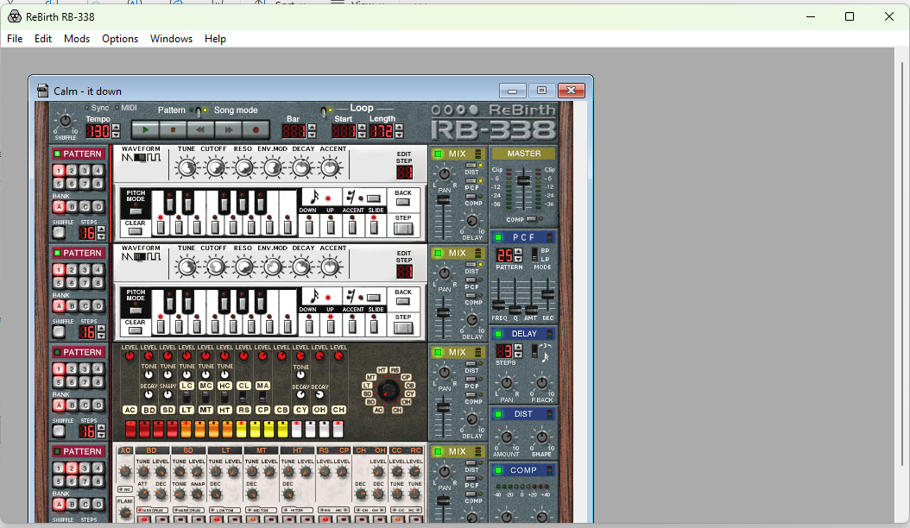
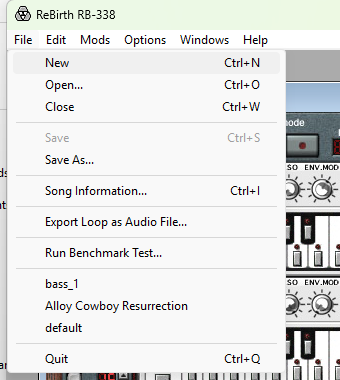
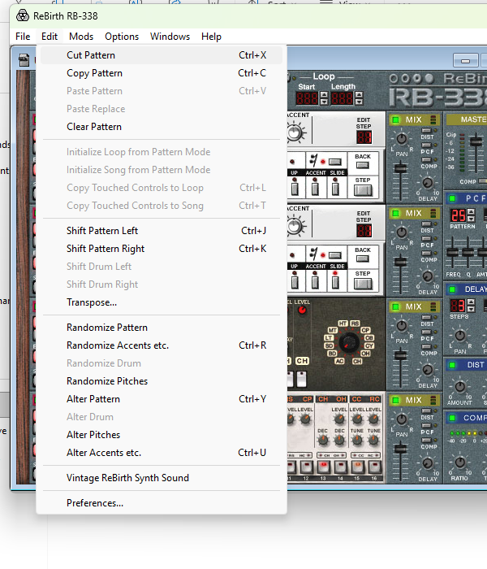
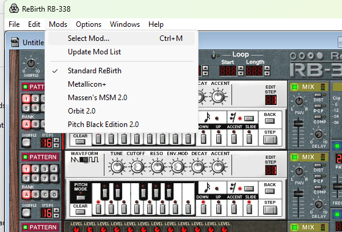
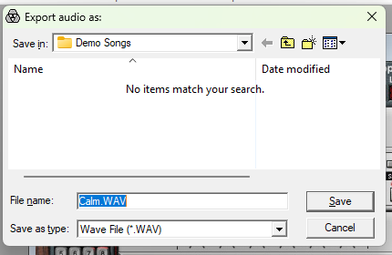
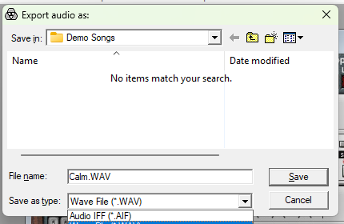
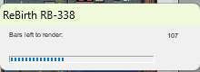
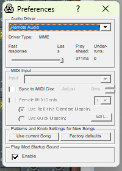
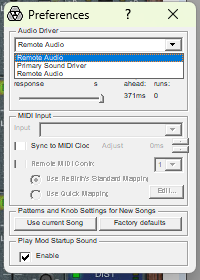

# The test machine and the installed ReBirth

How to use the ReBirth RB-338 2.01 installed on the Windows test machine, found out on 2026-10-26
(task-002). The agent brief (backlog doc-001) has the rules (permits, rcs); this document has the
facts about the app and its machine. Screenshots are in `docs/test_machine/`.

Commands below use `rcs` for `~/dev/dcre/common/tools/rcs_client.py`.

## 1. Folder layout

| What | Where |
|---|---|
| rcs server root | `C:\re` |
| rb's working folder (create once) | `C:\re\rb` (rcs path `rb/`) |
| The installation | `C:\ReBirth RB-338` (outside the rcs root; since dcre bd32edb rcs takes absolute paths anywhere: `rcs ls 'C:/ReBirth RB-338'`, `rcs get 'C:/ReBirth RB-338/Demo Songs/Calm.rbs' .`, `exec --cwd 'C:/ReBirth RB-338'`) |
| Preferences file | `C:\Users\pingw33n\AppData\Local\VirtualStore\Windows\ReBirth RB-338 2.prf` |
| The ReBirth CD (2026-10-27) | drive `E:` (label `RB338V20`): `Install ReBirth RB-338.exe`, `RB20FUL.DAT`, ... (`rcs ls E:/`, read-only). Its installer's Rebirth.exe is not the installed one (docs/rbm.md 13.1) |

The installation holds:

```
Rebirth.exe, ReBirth.dll          the original program (same bytes as original/)
ReBirth manual.pdf, ReBirth.hlp, ReBirth.cnt, ReadMe.rtf, ReWire.dll_, ReWire.reg
Default Songs\   ReBirth 1.0 Default Song.rbs, Silent Default Song.rbs, Read Me.txt
Demo Songs\      16 .rbs songs
Mods\            4 .rbm mods
```

Windows 11, user `pingw33n`, one RDP session (`RDP-Tcp#0`, session 2). The app is a 32-bit program
and ran as a normal user. The Windows file-virtualization of legacy programs sends its write to
`C:\Windows\ReBirth RB-338 2.prf` into the user's VirtualStore: that is where the preferences file
is. It does not exist in `C:\Windows` itself.

**Reading the installation.** `rcs ls`, `get` and `hash` take its absolute paths directly (rcs server from dcre bd32edb, running since 2026-10-26). The `exec` routes below also work; run read-only commands as separate arguments (no `>` redirection and no
quoted strings inside one argument: rcs re-quotes the line and `cmd` rejects it):

```
rcs exec cmd.exe /c dir /s 'C:\ReBirth RB-338'      # then: rcs output <id>
rcs exec robocopy 'C:\ReBirth RB-338' 'C:\re\rb\install' '*.rbs' '*.rbm' /E /NFL /NDL   # exit 1 = copied
rcs ls rb/install ; rcs get 'rb/install/Demo Songs/Calm.rbs' .
```

`C:\re\rb\install\` holds a copy of the shipped `.rbs` and `.rbm` files (made by task-002) and is the
folder to open songs from: the Open dialog accepts the full path typed into its file-name field.

## 2. Starting and stopping

```
rcs exec cmd.exe /c start "" /D 'C:\ReBirth RB-338' 'C:\ReBirth RB-338\Rebirth.exe'
rcs exec tasklist /V /FI 'IMAGENAME eq Rebirth.exe' /FO LIST ; rcs output <id>     # PID, window title
rcs exec taskkill /PID <pid>                                                       # stop it
```

`rcs ps` lists only the processes rcs started, and the `start` above returns at once, so the app's PID
comes from `tasklist`. Stop only the PID you started.

- Hold all the permits of `redc-win-run` (owner: your branch) from the start until the app is gone:
  the app takes the keyboard and the screen, and every input goes to the foreground window.
  A session of 15 minutes needs one `locky refresh` (lease 1800 s).
- At start a modal box "Failed opening MIDI input. No MIDI will be available..." (window title
  `ReBirth RB-338`, behind the splash) appears, because the machine has no MIDI device. Dismiss it:
  `rcs input --window "ReBirth RB-338" key:enter`. **No preference prevents it**: the MIDI input list in
  Preferences is empty and disabled (section 5). Use the Enter key at each start.
- Main window title: `ReBirth RB-338` (a Windows MDI frame; task-001's note that the title is the song name was wrong). The
  song is a child window inside it, titled with the song's name (`Untitled song` at start,
  `Calm - it down` after opening `Calm.rbs`). Under the frame there is no way to tell dialogs apart
  except by their titles, which `rcs input --window` and `rcs screenshot --window` accept: `Open Song:`,
  `Export audio as:`, `Preferences`.
- After a fresh start the frame is about 1052 x 551 client pixels at screen position (112, 155) on a
  1424 x 889 screen.
- Quitting through `taskkill` (no `/F`) closed the app cleanly and it rewrote the preferences file
  (section 5).



`rcs screenshot --window` saves the client area only (no menu bar and no title bar) and is wrong while a
modal child is up. For menus and dialogs use the full-screen `rcs screenshot out.png`, and crop
(`sips -c H W --cropOffset Y X`). Screen and screenshot coordinates are the same.

## 3. Driving the menus

`rcs input` has no `alt+f` key syntax: use `keydown:alt key:f keyup:alt`. Alt+F, Alt+E, Alt+M, Alt+O
and Alt+W open File, Edit, Mods, Options and Windows. In an opened menu the first `key:down` selects the
first item; disabled items are skipped; Enter chooses.



File: New (Ctrl+N), Open... (Ctrl+O), Close (Ctrl+W), Save, Save As..., Song Information... (Ctrl+I),
**Export Loop as Audio File...** (greyed until a song is open, so not in the `Untitled song`
state), Run Benchmark Test..., the recent files, Quit (Ctrl+Q).

- Edit: pattern editing items and, last, `Vintage ReBirth Synth Sound` (a song-level switch, checked
  or not per song) and `Preferences...`. Press Up once in the open Edit menu to wrap to
  `Preferences...`. 
- Mods: `Select Mod...` (Ctrl+M), `Update Mod List`, then `Standard ReBirth` (checked), `Metallicon+`,
  `Massen's MSM 2.0`, `Orbit 2.0`, `Pitch Black Edition 2.0`. 
- Options: Sync to MIDI Clock, Program Synth from Keyboard (Ctrl+F), Select Patterns from Keyboard
  (Ctrl+G, checked).
- Windows: Cascade, Resize Application Window to Documents, Stay on Top, the open songs.

## 4. Opening a song and exporting it

Route, tested with `Calm.rbs` (all by `rcs input --window <title>`):

1. `Ctrl+O` (keydown:ctrl key:o keyup:ctrl), wait 1 s. Dialog `Open Song:`; the file-name field has
   focus. Type the full path, `C:\re\rb\install\Demo Songs\Calm.rbs`, press Enter.
2. Some songs show a modal box with the song's info text (title, author) after loading; Enter closes it.
3. File, Export Loop as Audio File...: `Alt+F`, then 6 times Down, Enter (Song Information is the 5th, Export
   the 6th while Save is greyed). The dialog `Export audio as:`: 
   - "Save in" is the song's folder; file-name field holds `<song>.WAV`, selected.
   - "Save as type": `Wave File (*.WAV)` (default) or `Audio IFF (*.AIF)`.
     
4. Type the full path of the file into the file-name field (`C:\re\rb\calm_export.wav`), Enter. The
   field is selected on opening, so typing replaces it; do not send Ctrl+A first.
5. A progress box `ReBirth RB-338`, "Bars left to render: N" (107 for Calm), appears
   and closes when done (`Calm`: about 3 s of wall time). 
   The app's own player does not play meanwhile; the main window stays at Bar 1.
6. The file appears in `C:\re\rb`: `rcs ls rb`, `rcs get rb/calm_export.wav .`

Observed result for `Calm.rbs` (`WAV`): 56,013,828 bytes, RIFF PCM, 2 channels, 16 bit, 44100 Hz,
14,003,446 frames (317.5 s); the file's first samples are zero.
SHA-256 `d40fa858e61b0fb32911a1e6f651e66d44b02beb1c7a8b54e622e8167db38e50` (not a reference: made in
this task from a non-clean session, with a prior export attempt in the same process).

AIFF: a first attempt in this session (the type list opened with the mouse and closed with Esc, then
Ctrl+A and the typed path) wrote no file at `C:\re\rb\calm_export.wav`. It wrote `Calm.AIF` (56,013,866
bytes, `FORM....AIFFSSND`, SHA-256 `669477eaea45a3f538024bae7a333a2f5f32d621f5a603c7cdcb89571390e38b`) into
the song's folder under the default name, so the AIFF branch exists and has 38 bytes more than the WAV
(same payload size). Why the type list and the name field behaved so is not understood (probably the
click landed on the AIFF entry and the keys went to the list). Pass the full path with no earlier input
to the dialog, and check `rcs ls` for the file you asked for. The stray `Calm.AIF` was deleted from
`C:\re\rb\install\Demo Songs`.

## 5. Preferences that can change what the engine does

Edit, Preferences... (`Alt+E`, Up, Enter). Dialog `Preferences` (client area only 192 x 246 px).
It is non-modal and stays on screen; Esc does not close it, click its X (screen 785, 320 at the
position above), and a click on the title bar's `?`.

 

Current values (unchanged by task-002; the dialog was only opened):

| Setting | Value |
|---|---|
| Audio Driver | `Remote Audio` (list: `Remote Audio`, `Primary Sound Driver`, `Remote Audio`) |
| Driver Type | MME |
| Latency slider | "Less" end, Play ahead 371 ms, Underruns 0 |
| MIDI Input | none: Input list empty and disabled, so "Sync to MIDI Clock", "Remote MIDI Contr." and the mapping radios are greyed |
| Patterns and Knob Settings for New Songs | buttons `Use current Song` and `Factory defaults` (actions, not values) |
| Play Mod Startup Sound | Enable: **checked** |

What follows from the file and the app:

- **Startup sound.** `Play Mod Startup Sound: Enable` is the only startup-sound setting. The exe contains the
  name `Startup.aif` (`strings Rebirth.exe`); investigation 7.4 puts the sample at DLL resource 1024. The
  name says it is a mod's startup sound; nothing was heard or measured here whether it plays at start of
  the app, at loading a mod, or whether it reaches the export. **Not confirmed.** It is the
  preview-player path that docs/initial_investigation.md section 3 (Export path), step 4, says mixes into the output; task-010
  must decide whether to clear the checkbox.
- **Default song at start.** There is no "load Demo.rbs" or "Use Current Song" preference in this
  version. The `Untitled song` created at start is the new-song template stored in the preferences file
  at offset 0x4000 (a copy of a song, with its own copyright text): `Use current Song` writes it,
  `Factory defaults` resets it. Demo.rbs does not exist in this installation.
- **Audio driver.** `Remote Audio` is the RDP audio device (MME). The export does not play audio; whether
  the driver influences the exported samples is untested.
- The MIDI error at start cannot be removed with a preference (section 2).

**The preferences file** (`ReBirth RB-338 2.prf`, 32,768 bytes, a copy of it before this task's run is
`C:\re\rb\prf_before.prf`, SHA-256 `6309526e1574414dd3c093f97fedb5e7978428c789db94099c3af81ee8cbd51e`):

- offset 0x00: header `ff ef ef e5 bc 02 02 00`, a 0x38-byte copyright text;
- 0x100: audio driver name `Remote Audio`;
- 0x250, 0x1190 and 0x20c0 (slots about 0xf30-0xf40 apart, each preceded by 4 bytes `f1 1e 54 ec`...): the
  recent-file list, one NUL-padded path string per slot (before the run: `default.rbs`,
  `Alloy Cowboy Resurrection.rbs`, `bass_1.rbs`; the slot order versus the File menu order was not
  worked out);
- 0x4000: second block with the same copyright text: the new-song template;
- the Windows registry `HKCU\Software\Propellerhead Software\ReBirth RB-338` has `MainFramePlacement` and
  `StayOnTop`.

After the app was closed with `taskkill /PID` the file differed from before at 195 bytes, all in the recent
list (`Calm.rbs` was added); the template at 0x4000 and the driver name did not change. Because the file is
in the user's profile and is rewritten at exit, it is part of the machine state, not of rb: an
experiment that needs a fixed state should copy `prf_before.prf` back
(`cmd /c copy`) with the app closed.

**The user's file is restored after every run (task-062).** `tools/rb_export.py`:

1. Before it takes the permits it checks that `C:\re\rb\prf_before.prf` exists on the machine with the
   SHA-256 above; else it fails and starts nothing.
2. Before it writes the prefs file (`--restore-prf` / `--startup-sound`) or starts the app, it checks that no
   Rebirth.exe runs; if the user's instance runs, it fails without touching the file (the app would
   overwrite it at exit anyway).
3. Once it has written the file or started the app, on every exit path (normal end, Failure, other
   exception, timeout, KeyboardInterrupt), after the app it started has exited (it waits up to 30 s,
   polling, and never kills a process it did not start) and before the permits are released, it copies the
   saved file back over the VirtualStore file (`cmd /c copy /Y`) and checks the hash. A mismatch, a failed
   copy, or a Rebirth.exe still running after the wait fails the run (exit 1, logged `FAILED: preferences
   restore`).

The saved copy is never written. `tools/rbhost` does not start the app. Real session 2026-10-27:
`--startup-sound off` changed the file to `dc34d28e7903...` during the run and it was `6309526e...` after.

## 6. Permits

Applied to this app (doc-001): `locky acquire redc-win-run N --owner <branch> --acquire-timeout 3600
--lease-timeout 1800` with N the `permits` value from `locky list` (6 on 2026-10-26); everything that
starts the app, sends input to it or screenshots it runs under that lease, refreshed with `locky
refresh` at least every 25 minutes; release with `locky release redc-win-run all --owner <branch>` once
the app has been stopped. The read-only `cmd /c dir` and `rcs get` of the installation or of `C:\re\rb`
do not need them. An rb runner tool takes and releases them itself.

## 7. The shipped songs and mods

Songs are committed in `tests/songs/shipped/` (task-006 decision); the mods are not committed.
Sizes are the on-disk bytes; the Windows dates are 1998-06-29/30.

| File | Bytes | SHA-256 |
|---|---|---|
| A Taste of Haste.rbs | 27,532 | `baaadda4629e70fff662fb8594fa5056423de7d01dc16f3a18349142372894f0` |
| Alloy Cowboy Resurrection.rbs | 38,720 | `7dcf3563440921414a2fb818937fa9939097d92cb09311f6a8ad24237b8e158e` |
| Calm.rbs | 25,884 | `c468f82e00c927e21e81d7e7a2648e30fd9158a57e5f2865ed64f2c225e6d053` |
| Clodhopper.rbs | 18,814 | `f5ddc8b977fdd266d1278236238addeba3a56cf77c37bd805dde6805fa7df1c3` |
| Fast Forward.rbs | 42,578 | `1f3f29612953ffcb0309b44a4f033b66198e4dfa3b059ca751342c6ff1093781` |
| Fonda Workout.rbs | 20,342 | `687ac2bd2e887757e4dae98568f66ebedbe15c017457b489be3c41348228658b` |
| G-Spot.rbs | 42,598 | `8bed5f258cebf188a80fe95634c300a50431e910257e7f251983a2f21d4ade13` |
| Groove It Up a 2nd Time!.rbs | 40,220 | `7d9810881f9b6a0bffa004476f1cf27b59afa83a030e1b2031ba2753fdd61ea6` |
| Metallicon City.rbs | 26,296 | `9b4a891af8071650ccac325ded6bdc4a197753d04ccf1bdca5cfcbef3093def0` |
| Multiball Challenge.rbs | 24,204 | `7ef63cf13cc844effe3630d48b2a15e8ddf04b343addfe1de4cff852c1eebc9d` |
| Mutilated Species II.rbs | 55,580 | `16bc772d9ccfde4ee8e669948d7d344c9de81aa5c43e5fe603888def322a0ab2` |
| RSI.rbs | 27,386 | `39e51a632fd6c43f99105f8dcbaf20caf67c4894f0a67522d56f8cefc6ac2154` |
| SuperNova.rbs | 24,374 | `dd78b19e10ea323550198eef4f780612ed935146e00b8179ce076f7ce501eb82` |
| TGV's KiloMix '98.rbs | 39,384 | `0bf4f5f4eea17878374a1e5f73985817ccecdf403c8a473f31e0f5e6eb13a3c5` |
| Trakka Rekka.rbs | 26,998 | `d1accdc51ad890f93ae159d5c8648b5d85475243025fb391d94310137c17f890` |
| Transfusion.rbs | 27,680 | `cecd0e26c21d7ba0abcab58d9c34d0321316efc5355841167de5be35106505e0` |
| ReBirth 1.0 Default Song.rbs (Default Songs\) | 16,840 | `f23f9aa77fffa82d4c39c66548ece2cba80aff785b6e667dc7999d4f705de116` |
| Silent Default Song.rbs (Default Songs\) | 16,840 | `b85790424197492c81930431c5b34388f10ceb2a3791bbf43967854556ff0d49` |

Mods (`C:\ReBirth RB-338\Mods`, not committed; the rcs copies are in `C:\re\rb\install\Mods`):

| File | Bytes | SHA-256 |
|---|---|---|
| Metallicon.rbm | 3,532,098 | `ef68879dd40d6c3c3fd0745c9f89a7fa5784edbdc7af4a6bc3e7ac3a5962057e` |
| MSM2.rbm | 2,183,516 | `aced273bbb6440449ed0dd14d9999a45305bd74d21dcf80c6b5ec5719c59fb40` |
| Orbit2.rbm | 5,063,584 | `852e9f9ba207337a781eda7ac609b6bf0fe2040889aabb3be6453d95f510b8fa` |
| PBE2.rbm | 3,623,024 | `797ea0f74d6fd2ee7d8e70ff0baf375a6d89686c64dfda47bc435006990ad951` |

**The installation's Mods are recrypted (task-063, 2026-10-27).** At the user's explicit request (the one
exception to "never write into the installation", for these four files only) the files in
`C:\ReBirth RB-338\Mods` were replaced by their `rb recrypt` form (docs/rbm.md section 12), after the
originals were copied to **`C:\re\rb\mods_orig`** (`robocopy`, hashes equal to the table above; never
delete it). The table above is the ORIGINALS' (also the committed manifest's); the installation now has:

| File | Bytes | SHA-256 |
|---|---|---|
| Metallicon.rbm | 3,533,130 | `12fbe6982b664abd42d03a9a329e7f0597ecddc89b674581ee5c4c7914f2bbd4` |
| MSM2.rbm | 2,184,548 | `28cb40e0ae02a49a05c866d480ba982da84d5dba5cf3a6605e05f1f4418aa604` |
| Orbit2.rbm | 5,064,616 | `eb1843b685514f22b379720733dbea4cf58111107eb353d53ea6634829f2114c` |
| PBE2.rbm | 3,624,056 | `62789353966b7ca7d4c0bd55b14981fdb49b94371c535224bb1f581eb15ccb97` |

The app loaded them with no extra box; one export of Fonda Workout (MSM2) from the installation
(`rb_export.py --restore-prf`, the wav `548cece4...fff15`) equals `rb compare ... --idle-blocks 3600`
with the recrypted MSM2 (one EQUAL among N 3400..3707). After the export `rb_export.py` restored the user's preferences file
(sha256 `6309526e1574...`, checked) and released the permits. `C:\re\rb\install\Mods` still holds the
original copies. To go back: copy `C:\re\rb\mods_orig\*.rbm` over the installation's Mods (only with
no Rebirth.exe running, under all permits).

The installation's `Rebirth.exe` and `ReBirth.dll` hashes are in task-001's notes.

## 8. The export runner `tools/rb_export.py` (task-008)

`tools/rb_export.py [options] SONG.rbs... -o OUTDIR` runs sections 2 to 4 unattended under all the
permits (it reads the count from `locky list`, refreshes, releases also on failure) and writes
`OUTDIR/<stem>.wav` and `OUTDIR/<stem>.json` (protocol, timings, the song's hash, the WAV's hash and
RIFF check). It drives the app with the rcs server's `input` and `screenshot` (no UI automation
library on the machine); a dialog is "up" when `screenshot --window <title>` succeeds. Options for
the capture protocol (`docs/export_state.md` section 9): `--restore-prf [LOCAL]` (restores the
preferences file before each start, default from `C:\re\rb\prf_before.prf`), `--startup-sound on|off`,
`--wait-after-open S` (default 2; `docs/export_state.md` section 11.6 for the faster waits),
`--play-seconds S` (Space, wait, Space), `--exports K`, `--reuse-process`. The runner tells the MIDI
box and the song-info box from the main window by the size of the frame window's screenshot (the
box and the main window have the title "ReBirth RB-338"; 45814 against 1739010 bytes, threshold
200000, measured at the machine's one screen setup). Limit: another screen size or DPI scaling
changes both sizes. A main window below the threshold is taken for a box: the runner presses
Enter in the main window at the start, then waits 15 s for a main window and fails ("the main
window did not appear", with the screenshot saved); a box above it is never seen and the run fails
the same way after 15 s. Nothing else is sent to a wrong window. Re-measure the two sizes (`MAIN_WINDOW_MIN_BYTES` in `tools/rb_export.py`) after such a
change. The file is accepted when its size is stable and equals
`44 + 4 * frames` from the export length formula (`docs/initial_investigation.md` section 3) and the
downloaded RIFF is consistent; it stops only the `Rebirth.exe` it started (by PID: `taskkill`, then
`/F` after 15 s) and refuses to start if a `Rebirth.exe` already runs. A failed step saves
`OUTDIR/<stem>.fail.bmp`, stops the app, releases the permits and exits 1. Gap: only WAV (the AIFF
type list is not driven, section 4).

Facts found while writing it (2026-10-26):

- **Export Loop as Audio File is greyed in pattern mode** (GLOB `song_mode` 0, the "Pattern" /
  "Song mode" switch): a song built with `song_mode` 0 had it greyed, fresh, playing or stopped; with
  `song_mode` 1 it was enabled in all three. A greyed item is skipped by Down, so the 6-Downs route
  would land on `Run Benchmark Test...`. The runner refuses pattern-mode songs.
  The shipped default songs (`Silent Default Song`, `ReBirth 1.0 Default Song`) are pattern mode.
- **The song-info box** ("ReBirth RB-338", the song's USRI text, OK button) appears after loading iff
  USRI `show_on_open` is set; Enter dismisses it. If it is up, the menu keys are swallowed.
- **Space plays and stops** in the main window (the play button lights); after Alt+menu, `Esc` twice
  first, else Space opens the window's system menu. Play does not disable Export. The Bar display
  stayed `888` while "playing" on `Remote Audio`.
- **The frame's screen position changes at every start** (it moves by about 25 px, from the
  registry's `MainFramePlacement`), and the song child window is cascaded, so mouse coordinates
  are not stable; use keys.
- **Startup sound in the preferences file: byte 0x20A** (522) of `ReBirth RB-338 2.prf`, 1 =
  "Play Mod Startup Sound: Enable" checked (the saved copy), 0 = cleared. Clearing the checkbox in
  the dialog and quitting changed only this byte and the recent-file list. The checkbox is at screen
  (637, 562) and the dialog's X at (785, 320) for a frame at (112, 105).
- Exports in one process of the same song gave different SHA-256 (Fonda Workout, first and second
  export after a 3 s play); this is task-010's question, not analyzed here.

## 9. rbhost, the offline host (task-011)

`tools/rbhost/run.py` renders songs with the installed `C:\ReBirth RB-338\ReBirth.dll` (loaded in
place; nothing is written to the installation) without the app, and refuses to run while a
`Rebirth.exe` is running: it uploads `rbhost.exe` and a message file to `C:\re\rb\rbhost` and runs
it with `rcs exec`. rbhost takes neither the keyboard nor the screen, so the runner holds **one**
permit of `redc-win-run`, not all of them. A render takes about 50 ms on the machine plus about 1 s
of rcs traffic. Usage and options: `tools/rbhost/README.md`; what the DLL needs:
`docs/export_state.md` section 12.

## 10. Driving the panel with the mouse (task-041, 2026-10-27)

- **The whole panel is visible after a fresh start**: the song window opens at the panel's full
  size, 624 x 510 client pixels (`docs/ui_spec.md` section 1). On that day its top-left corner
  was at screen (42, 108). `rcs screenshot --window <song title>` fails ("no visible window"):
  the song window is an MDI child, not a top-level window. Take the full screen and crop; the
  panel's position can be found by matching the transport's logo art.
- **Mouse input works with screen coordinates** (`rcs input move:X,Y down move:... up`, no
  `--window`), and the drags reach the knobs and faders as real drags (knob values measured
  through a saved song). Click inside the control's frame, not its bitmap: a 2-frame button of a
  35 px bitmap is 17 px wide (`docs/ui_spec.md` section 2).
- **Alt as a modifier is unreliable** through `rcs input keydown:alt`: releasing Alt can open the
  menu bar. Ctrl+Alt and Ctrl clicks worked.
- **Saving**: Ctrl+S on an unsaved song opens `Save Song as:`; typing the full path and Enter
  saves (16,840 bytes for the template song).
- **Quitting a modified song with `taskkill /PID`** (no `/F`) shows a modal "Save changes before
  close?" box with Save, Cancel and Don't Save; the app keeps running until a button is pressed.
  Don't Save was at screen (774, 470) for the frame position above.
