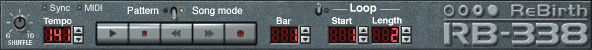
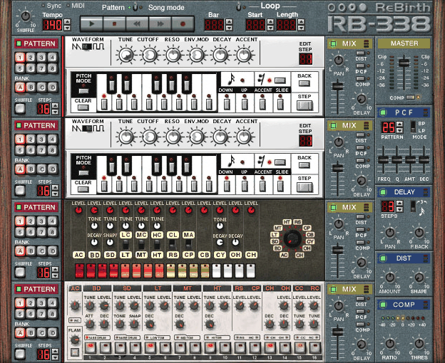
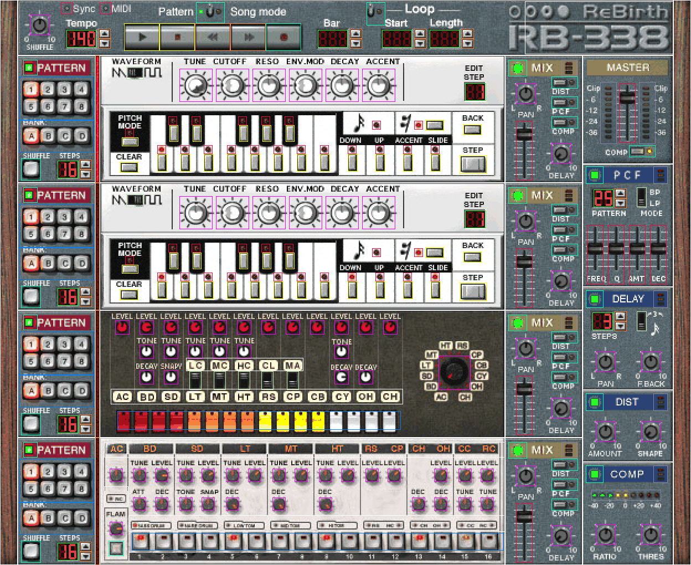

# UI spec: the ReBirth RB-338 2.01 panel

The layout and behavior of the original's song window ("the panel"), written for rb's own UI
(milestone m-3: task-042 draws the art, task-044 builds the widgets, task-045 wires them to the
engine, task-047 adds the menu). It describes the original, not its art: rb draws its own
graphics at these positions. Written for task-041 (2026-10-27).

**Sources.**
- `Rebirth.exe` in IDA (`ida/Rebirth.exe.i64`, headless copy, read-only). The panel is a tree of
  views with RTTI names (`CTransportView`, `CTB303View`, `CTR808View`, `CBitmapKnob`, ...). Each
  view has a layout method (vtable slot 22) that places its children with `sub_47E10F(x, y)`
  (move) or `sub_47E04C(x, y, w, h)` (frame), relative to the parent; a constructor that creates
  the children (class and bitmap); and a poll method (vtable slot 17) that reads each child's
  pending change and sends it to the engine. Matching the child offsets (`ecx = this + off`)
  across the three gives each control's position, class and parameter.
- The panel art: 64 JPEG resources (type 1053) in `Rebirth.exe`, registered by `CReBirthBitmaps`
  (0x4287A0) with their frame counts. Each section background is a JPEG of exactly the section's
  size, which makes them the measurement reference. They are Propellerhead artwork and are **not**
  committed; extract them with any PE resource reader if needed.
- Screenshots of the running app on the test machine (`docs/test_machine.md`), at the native
  size (no scaling): `ui_spec/panel.png` and the others in section 14.
- The manual (`rebirth_2.01_manual.pdf`, pages 16-87, 143-180, 221-226). Where the manual and the
  code disagree the code wins; the differences are listed in section 13.

**Marks.** [C] = read in the code (address given) or observed in the app; [G] = guessed or only
partly traced. Addresses `0x4xxxxx` are `Rebirth.exe`.

**Coordinates.** All positions are in pixels of the original panel, origin top left, x right,
y down. Tables give the control's rectangle relative to its section (`x y w h`) and, for a
scalable UI, the rectangle's top-left corner and size as fractions of the whole panel (`x/W`,
`y/H`, `w/W`, `h/H` with W = 624, H = 510). A control's rectangle is its hit area and its drawn
area (the views have no separate hit margins). The overlay `ui_spec/panel_controls.png` draws
every rectangle of this document over the screenshot (2x) as a check.

**Engine parameters.** "ctrl n" is the device controller n of `docs/song_load.md` (section 4 for
the chunk bytes, section 5 for the controller numbers, which are equal to the RBS chunk offsets);
"msg 35 id n" is the global set message of `docs/song_load.md` section 3. The device numbers are
the track numbers: 0 mixer, 1 and 2 TB-303, 3 TR-808, 4 TR-909, 5 delay, 6 distortion, 7 PCF,
8 compressor.

## 1. The window and the panel

**Size [C].** The panel is 624 x 510 px (`sub_42A8FE`). The song window's client area is limited
to the panel's width and to a height between 165 (transport plus one row) and 510
(`sub_42D77F`). The transport stays at the top; the rest (the "rack", 460 px high) scrolls
vertically when the window is lower than 510: the scroll bar is enabled when the visible rack
height is below 460, with a line step of 14 px and a page step of 115 px (`sub_42AF63`).

**Sections [C]** (`sub_42A8FE`; the rack is placed at (16, 50), its children are listed here in
panel coordinates):

| Section | x | y | w | h | x/W | y/H | w/W | h/H |
|---|---|---|---|---|---|---|---|---|
| Wood, left | 0 | 0 | 16 | 510 | 0.0000 | 0.0000 | 0.0256 | 1.0000 |
| Wood, right | 608 | 0 | 16 | 510 | 0.9744 | 0.0000 | 0.0256 | 1.0000 |
| Transport | 16 | 0 | 592 | 50 | 0.0256 | 0.0000 | 0.9487 | 0.0980 |
| Pattern section, row 1 | 16 | 50 | 70 | 115 | 0.0256 | 0.0980 | 0.1122 | 0.2255 |
| Focus bar, row 1 | 86 | 50 | 4 | 115 | 0.1378 | 0.0980 | 0.0064 | 0.2255 |
| TB-303 #1 | 90 | 50 | 366 | 115 | 0.1442 | 0.0980 | 0.5865 | 0.2255 |
| Mixer channel 1 | 456 | 50 | 70 | 115 | 0.7308 | 0.0980 | 0.1122 | 0.2255 |
| Pattern section, row 2 | 16 | 165 | 70 | 115 | 0.0256 | 0.3235 | 0.1122 | 0.2255 |
| Focus bar, row 2 | 86 | 165 | 4 | 115 | 0.1378 | 0.3235 | 0.0064 | 0.2255 |
| TB-303 #2 | 90 | 165 | 366 | 115 | 0.1442 | 0.3235 | 0.5865 | 0.2255 |
| Mixer channel 2 | 456 | 165 | 70 | 115 | 0.7308 | 0.3235 | 0.1122 | 0.2255 |
| Pattern section, row 3 | 16 | 280 | 70 | 115 | 0.0256 | 0.5490 | 0.1122 | 0.2255 |
| Focus bar, row 3 | 86 | 280 | 4 | 115 | 0.1378 | 0.5490 | 0.0064 | 0.2255 |
| TR-808 | 90 | 280 | 366 | 115 | 0.1442 | 0.5490 | 0.5865 | 0.2255 |
| Mixer channel 3 | 456 | 280 | 70 | 115 | 0.7308 | 0.5490 | 0.1122 | 0.2255 |
| Pattern section, row 4 | 16 | 395 | 70 | 115 | 0.0256 | 0.7745 | 0.1122 | 0.2255 |
| Focus bar, row 4 | 86 | 395 | 4 | 115 | 0.1378 | 0.7745 | 0.0064 | 0.2255 |
| TR-909 | 90 | 395 | 366 | 115 | 0.1442 | 0.7745 | 0.5865 | 0.2255 |
| Mixer channel 4 | 456 | 395 | 70 | 115 | 0.7308 | 0.7745 | 0.1122 | 0.2255 |
| Master | 526 | 50 | 82 | 98 | 0.8429 | 0.0980 | 0.1314 | 0.1922 |
| PCF | 526 | 148 | 82 | 111 | 0.8429 | 0.2902 | 0.1314 | 0.2176 |
| Delay | 526 | 259 | 82 | 93 | 0.8429 | 0.5078 | 0.1314 | 0.1824 |
| Dist | 526 | 352 | 82 | 65 | 0.8429 | 0.6902 | 0.1314 | 0.1275 |
| Comp | 526 | 417 | 82 | 93 | 0.8429 | 0.8176 | 0.1314 | 0.1824 |

The layout gives the woods a frame of 16 x 395 (`sub_42A8FE`); their art (resource 12062) is
16 x 510 and fills the panel height in the screenshot. Draw them full height [C: screenshot].

**Focus [C].** One of the four rows has the focus (window byte `+140`, 1..4; 1 at creation,
`sub_42DA72`). It is shown by the row's focus bar (resource 12068, two frames: off, lit orange).
The focus moves by a click anywhere inside a row (`sub_42ADBB` tests the four row rectangles), a
click on a focus bar, the selection of a pattern in a row, and the Up/Down arrow keys
(section 10). Up from row 1 goes to row 4 and Down from row 4 to row 1 (`sub_42D1D3`, key codes
'T' and 'V'). The focus decides where the computer keyboard's synth and tap keys go and which
pattern the Edit menu's pattern items act on.

**Pattern mode and song mode [C].** The transport's Pattern/Song switch sets global byte 0
(msg 35 id 0). The UI does not change layout between the modes. In pattern mode the bar and loop
displays are disabled (dark; `sub_42A058` calls `sub_47DCFB(0)` on the three displays) and the
loop does nothing; in song mode they show the song position and the loop, and every automated
control moves with the song (the panel shows the engine's live values; `docs/song_load.md`
section 6 for which values the engine takes from the tracks). Turning song mode off also turns
record off (`sub_42A058`).

## 2. Widget classes

The panel uses a small set of widget classes. Each control's class is in its table's "Kind"
column. Values passed to the engine are 0..127 unless stated.

**Knob** (`CBitmapKnob`, ctor 0x4A60D0, mouse-down 0x4A6437, drag 0x4A64E5) [C].
- The knob keeps a position p in 0..1000. Mouse down anywhere on the knob grabs it (no jump).
  Dragging changes p by `1000 * (y_down - y) / span`, clamped to 0..1000: **up increases**, down
  decreases, horizontal motion is ignored. `span` is the ctor's fourth argument, in pixels for
  the full range: TB-303 62, TR-808 36 (the instrument selector 40), TR-909 41, all other knobs
  (transport shuffle, mixers, delay, dist, comp) 64.
- **Fine adjust:** with Shift held at mouse down (`GetKeyState(VK_SHIFT)`, the ctor's fifth
  argument 35 selects Shift, `sub_4A659C`) the span is 5 times larger.
- Value sent = `(127 * p + 500) / 1000` (integer, `sub_467F1A`), sent only when it changes
  (`sub_4A631A`). A value from the engine sets `p = (1000 * v + 63) / 127` (`sub_4A637D`).
- Drawn frame = `((n - 1) * p + 500) / 1000` of an n-frame film strip (`sub_4A6204`; n = 32 for
  the 18 x 19 knobs, 54 for the 303's 30 x 30, 36 for the 808's 13 x 13, 41 for the 909's
  12 x 12, 12 for the 808 instrument selector).
- No detents: every knob is continuous over 0..127 (the 808 selector is quantized by its user,
  section 6). No double-click, wheel or keyboard behavior exists.
- Measured in the app (2026-10-27): CUTOFF dragged to 0, then 31 px up, saved as 64
  (`1000*31/62 = 500`, value 64); RESO with Shift, 31 px up from 0, saved as 13 [C].

**Fader** (`CBitmapFaderView`, ctor 0x469240, mouse-down 0x469708, drag 0x46965F) [C].
- Handle 15 x 11 (resource 12031) on a 15 x 54 track (12032); position p in 0..999.
  Travel = 54 - 11 = 43 px; scale `k = 10000 / 43`.
- Mouse down on the handle grabs it; mouse down elsewhere on the track jumps the handle's center
  to the pointer: `p = (bottom - y - 11/2 + 2) * k / 10` (integer), clamped.
- Drag: `p = p_down + k * (y_down - y) / 10`, clamped to 0..999; up increases. No fine mode.
- Value sent = `(127 * p + 500) / 1000` (`sub_469614`).

**Toggle button** (`CToggleBitmapButton`, mouse-down 0x425092) [C]: each mouse-down flips the
state (two frames: off, on). Used for on/off switches, the Pattern/Song switch, Record and Loop.

**Trigger button** (`CTriggerBitmapButton`, mouse-down 0x425187, mouse-up 0x4251EA) [C]: shows its
pressed frame while held; the action runs once at mouse-down (the polls act on the "pressed"
event only, e.g. `sub_43ED76`). Used for Play, Stop, the 303's keys and step buttons.

**Repeat button** (`CRepeatBitmapButton`, ctor 0x4A6A70, timer 0x4A6CB6, count 0x4A6C30) [C]:
one step at mouse-down [G: the press handler at vtable +100 was not read; one click gave one step
in the app], then, while held, the number of extra steps after t ms is
`(t >= 400 ? min(t - 400, 2399) / 100 : 0) + (t >= 2400 ? (t - 2400) / 20 : 0)` (integer
divisions, `sub_4A6C30`): one per 100 ms from 400 ms, and from 2400 ms one more per 20 ms. The
steps are counted and taken by the poll (`sub_4A6DD9`). Used for the value-display arrows.

**Wind button** (`CWindButton`, `sub_429132`) [C for the class, G for the timing]: a repeat button
of the transport (rewind, fast forward, bar up/down); the counts are taken by the transport poll
like the repeat buttons'.

**Two-position switch** (`CBitmapSwitch`, ctor 0x4247D3, hit 0x424805) [C]: the value is set by
where the click lands, not toggled: for a horizontal switch (ctor argument 13) the left half
gives 0 and the right half 1; for a vertical one (argument 12) the top half gives 0 and the
bottom half 1. Dragging across the middle changes it (mouse-move 0x4245B2).

**Position grid** (`CABCPositionView`, mouse-down 0x42445E) [C]: a picture with n+1 frames
(frame 0 = nothing lit, frame k = button k lit) whose click position selects a button; the
pattern grid is 4 x 2 (`sub_41A5B0`: `col = clamp(4 * dx / 68, 0, 3)`,
`row = clamp(2 * dy / 40, 0, 1)`, button = `4 * row + col + 1`), the bank row 4 x 1 [G: same
class, the bank's hit function was not read].

**LED** (`CLEDView`, `sub_424612`): two frames (off, lit), display only [C].

**Seven-segment display** (`CLEDNumberView`, `sub_4252DD`) [C]: n digits of 9 x 16 px (resource
12015, 11 frames: digits 0..9 and blank), right-aligned, leading zeros blank (screenshots:
"16", " 3", "140"). A disabled display shows all segments dark.

**Meters** (`CPeakMeterView` `sub_4248B6`, `CHorisontalMeterView` `sub_424ACC`): display only;
the frame follows the engine's meter byte (`sub_424220`, `sub_424A7E`) [C for the wiring, G for
the scale].

## 3. Transport

Section (16, 0, 592, 50). Layout `sub_4298B9`, ctor `sub_4291E9`, poll `sub_42A058` [C].

| Control | x | y | w | h | x/W | y/H | w/W | h/H | Kind | Drives |
|---|---|---|---|---|---|---|---|---|---|---|
| Shuffle knob | 11 | 13 | 18 | 19 | 0.0433 | 0.0255 | 0.0288 | 0.0373 | knob | msg 35 id 20 (GLOB shuffle 0..127) |
| Sync LED | 39 | 2 | 11 | 11 | 0.0881 | 0.0039 | 0.0176 | 0.0216 | led | MIDI sync (out of scope) |
| MIDI LED | 74 | 2 | 11 | 11 | 0.1442 | 0.0039 | 0.0176 | 0.0216 | led | MIDI input (out of scope) |
| Tempo display (3 digits) | 44 | 27 | 27 | 16 | 0.0962 | 0.0529 | 0.0433 | 0.0314 | display | tempo / 1000 |
| Tempo up | 73 | 26 | 11 | 9 | 0.1426 | 0.0510 | 0.0176 | 0.0176 | repeat | msg 35 id 4, +1000 |
| Tempo down | 73 | 35 | 11 | 9 | 0.1426 | 0.0686 | 0.0176 | 0.0176 | repeat | msg 35 id 4, -1000 |
| Pattern / Song mode switch | 161 | 2 | 26 | 19 | 0.2837 | 0.0039 | 0.0417 | 0.0373 | toggle | msg 35 id 0 |
| Play | 96 | 21 | 32 | 25 | 0.1795 | 0.0412 | 0.0513 | 0.0490 | trigger | msg 35 id 1 = 1 |
| Stop | 128 | 21 | 32 | 25 | 0.2308 | 0.0412 | 0.0513 | 0.0490 | trigger | msg 35 id 1 = 0, or id 8 |
| Rewind | 160 | 21 | 32 | 25 | 0.2821 | 0.0412 | 0.0513 | 0.0490 | wind | msg 35 id 8, -10 bars |
| Fast forward | 192 | 21 | 32 | 25 | 0.3333 | 0.0412 | 0.0513 | 0.0490 | wind | msg 35 id 8, +10 bars |
| Record | 224 | 21 | 32 | 25 | 0.3846 | 0.0412 | 0.0513 | 0.0490 | toggle | msg 35 id 2 |
| Bar display | 271 | 27 | 27 | 16 | 0.4599 | 0.0529 | 0.0433 | 0.0314 | display | position / 768 + 1 |
| Bar up | 300 | 26 | 11 | 9 | 0.5064 | 0.0510 | 0.0176 | 0.0176 | wind | msg 35 id 8, +1 bar |
| Bar down | 300 | 35 | 11 | 9 | 0.5064 | 0.0686 | 0.0176 | 0.0176 | wind | msg 35 id 8, -1 bar |
| Loop on/off switch | 315 | 2 | 17 | 21 | 0.5304 | 0.0039 | 0.0272 | 0.0412 | toggle | msg 35 id 3 |
| Loop start display | 329 | 27 | 27 | 16 | 0.5529 | 0.0529 | 0.0433 | 0.0314 | display | start / 768 + 1 |
| Loop start up | 358 | 26 | 11 | 9 | 0.5994 | 0.0510 | 0.0176 | 0.0176 | repeat | msg 35 ids 12, 16 |
| Loop start down | 358 | 35 | 11 | 9 | 0.5994 | 0.0686 | 0.0176 | 0.0176 | repeat | msg 35 ids 12, 16 |
| Loop length display | 372 | 27 | 27 | 16 | 0.6218 | 0.0529 | 0.0433 | 0.0314 | display | (end - start) / 768 |
| Loop length up | 401 | 26 | 11 | 9 | 0.6683 | 0.0510 | 0.0176 | 0.0176 | repeat | msg 35 id 16 |
| Loop length down | 401 | 35 | 11 | 9 | 0.6683 | 0.0686 | 0.0176 | 0.0176 | repeat | msg 35 id 16 |
| Logo (click: mod startup sound) | 458 | 1 | 134 | 48 | 0.7596 | 0.0020 | 0.2147 | 0.0941 | area | top-level msg 58 |

Behavior (all [C], `sub_42A058` and its callees, ticks: 768 per bar):
- **Tempo.** Each arrow step adds or subtracts 1000 (1 BPM), clamped to 20000..500000
  (20..500 BPM, `sub_467EBB`), ignored while synced to MIDI clock (`sub_4094D4`). The display
  shows `tempo / (((dword_4D90BC & 0xFFFFF0) >> 5) - 2)`, the copy-protected divisor whose
  intended value is 1000: the integer BPM [G for the divisor value; the screenshot shows 140 for
  140000 and 141 after one step up].
- **Shuffle.** The knob is the global shuffle amount (one value for all sections); each pattern's
  Shuffle button decides whether the pattern uses it (section 4). The manual's "two o'clock gives
  a triplet feel" is the knob near 100.
- **Play** sends play (msg 35 `{1, 1}`). In song mode it continues from the song position.
- **Stop** (`sub_429FE6`): turns record off; if playing, stops (`{1, 0}`); if stopped, locates
  (`{8, t}`) to the loop start, or to 0 when the position is at or before the loop start
  (`start >= position`). So stop, stop, stop always reaches bar 1.
- **Rewind / fast forward** move the position by -7680 / +7680 ticks (10 bars) per step, from the
  start of the current bar (`sub_429DF2`: `t = step + 768 * (pos / 768)`), clamped to
  0..766464 (`sub_429DBF`; 766464 is the start of bar 999). Rewind and fast forward also turn
  record off.
- **Bar up / down** move by +768 / -768 ticks the same way; bar down turns record off, bar up
  does not (step recording, manual page 77).
- **Loop start up / down** (`sub_429E5B`): new start = `768 * (clamp(start + d, 0, 766464) / 768)`;
  the length is kept: end = `clamp(old_length + start, start + 768, 766464)`; sends `{12, start}`
  then `{16, end}`.
- **Loop length up / down** (`sub_429F18`): length = `768 * (clamp(end - start + d, 768,
  767232 - start) / 768)`, end = start + length, sends `{16, end}`. Length is 1 bar at least.
- **Displays.** In song mode: bar = `position / 768 + 1` (when the transport's flag `+76` is set,
  a held position `+72` is shown and moved instead of locating; what sets the flag was not traced
  [G]), loop start = `start / 768 + 1`, loop length =
  `(end - start) / 768`. In pattern mode the three are disabled.
- **Record** toggles global byte 2 (msg 35 id 2); the recording itself is the engine's
  (`docs/initial_investigation.md` section 5.3). It has no function in pattern mode: its press
  is tested inside the song-mode block of `sub_42A058` (0x42A1C7), with Rewind, Fast forward and
  the bar and loop arrows. The mode switch sends `{0, m}` and, for pattern mode, `{2, 0}` after
  it whatever record was (0x42A49B, 0x42A4CC). The song end turns record off in the engine
  (`{2, 0}` to the host), and the LED follows.
- **LEDs:** Play lit while playing (`+45`), Record lit while recording (`+46`), the mode switch
  shows song mode (`+44`), the Loop switch the loop flag (`+47`).
- **Logo click** (`sub_42A799`) sends top-level msg 58 with the current mod: the mod's startup
  sound plays. It does not test the preference "Play Mod Startup Sound" nor the mod's user count
  (0x42A7D3..0x42A7F1: `sub_40CB32`, the document's mod id `sub_4166D0`, `sub_40ABB5`), so a
  click plays the sound with the preference off [C, task-074]. rb: `layout::on_logo` and
  `Link::startup_sound` (`App::focus_click`). The code's hit rectangle is `sub_479B06(458, 1, 608, 49)` = left 458, top 1,
  right 608, bottom 49, all four in transport coordinates; its right edge lies 16 px beyond the
  transport's own right edge (592 in transport coordinates), so the effective area is clipped to
  x 458..591, y 1..48 in transport coordinates, i.e. panel x 474..607 (the table row: x 458,
  w 134, h 48).
- The Sync and MIDI LEDs (three frames: off, green, red) belong to MIDI, which is out of scope;
  draw them dark.

## 4. Pattern sections (one per row)

Section (16, 50 + 115 r, 70, 115), r = 0..3 for TB-303 #1, TB-303 #2, TR-808, TR-909.
Layout `sub_41A9A0`, poll `sub_41AB67` [C]. The table gives row 1; add 115 px (0.2255 H) per row.

| Control | x | y | w | h | x/W | y/H | w/W | h/H | Kind | Drives |
|---|---|---|---|---|---|---|---|---|---|---|
| On/off LED button | 5 | 4 | 13 | 14 | 0.0337 | 0.1059 | 0.0208 | 0.0275 | toggle | device ctrl 0 (enabled) |
| Pattern buttons 1-8 (4x2 grid) | 1 | 19 | 68 | 40 | 0.0272 | 0.1353 | 0.1090 | 0.0784 | grid | device ctrl 1 (pattern 0..31) |
| Bank buttons A-D (4x1) | 1 | 58 | 68 | 30 | 0.0272 | 0.2118 | 0.1090 | 0.0588 | grid | UI only (shown bank) |
| Shuffle button | 3 | 93 | 18 | 20 | 0.0304 | 0.2804 | 0.0288 | 0.0392 | toggle | current pattern's shuffle flag |
| Steps display (2 digits) | 36 | 95 | 19 | 16 | 0.0833 | 0.2843 | 0.0304 | 0.0314 | display | current pattern's length |
| Steps up | 56 | 94 | 11 | 9 | 0.1154 | 0.2824 | 0.0176 | 0.0176 | repeat | length + 1 |
| Steps down | 56 | 103 | 11 | 9 | 0.1154 | 0.3000 | 0.0176 | 0.0176 | repeat | length - 1 |

The On/off LED's x (5) is a copy-protection expression in the layout; 5 is where the LED's
sprite matches the background art [C: template match, mean difference 5 of 255].

Behavior [C]:
- **Bank buttons** only change the shown bank (`vt+132`). No pattern changes until a pattern
  button is pressed (manual page 147).
- **Pattern buttons** select pattern `(button - 1) + 8 * shown_bank` (`vt+100`, the device's
  controller 1); the click also gives the row the focus (the window's click handler `sub_42ADBB`).
  The grid lights button `(pattern & 7) + 1` only when
  `pattern / 8` is the shown bank; otherwise no button is lit. The bank row lights the shown bank.
- **Timing.** The selection is sent at once; the engine latches a new pattern (and the on/off
  state) only at the next absolute bar line (`(tick / 48) & 15 == 0`, `docs/initial_investigation.md`
  section 5), not at the end of the playing pattern as the manual says (page 21). In song mode
  with record on, the engine writes the change into the track quantized to the bar
  (`docs/initial_investigation.md` section 6.4, slot 7).
- **On/off** switches the section off: the engine plays nothing for it from the next bar line
  (like an empty pattern).
- **Shuffle** toggles the current pattern's shuffle flag (pattern data, `vt+112`).
- **Steps** change the current pattern's length, clamped to 1..16 (`vt+108`); the change is
  immediate (manual page 36). The display shows the length.
- Both are sent as the pattern-header message `{pattern, field, v}`, field 0 shuffle, 1 length
  (msg 41 sub 42 / 59 / 76, senders `sub_43ECCA`, `sub_441CC9`, `sub_445C88`;
  `docs/song_load.md` section 4.10, which lists every device message of the panel).

## 5. TB-303 (two)

Section (90, 50, 366, 115) for #1 and (90, 165, 366, 115) for #2 (add 0.2255 H to the y
fractions below). Layout `sub_43FB06`, ctor `sub_43D601`, poll `sub_43ED76` [C].

| Control | x | y | w | h | x/W | y/H | w/W | h/H | Kind | Drives |
|---|---|---|---|---|---|---|---|---|---|---|
| Waveform switch | 24 | 10 | 16 | 12 | 0.1827 | 0.1176 | 0.0256 | 0.0235 | hswitch | ctrl 8 (0 saw left, 1 square right) |
| Tune knob | 72 | 12 | 30 | 30 | 0.2596 | 0.1216 | 0.0481 | 0.0588 | knob | ctrl 2 |
| Cutoff knob | 105 | 12 | 30 | 30 | 0.3125 | 0.1216 | 0.0481 | 0.0588 | knob | ctrl 3 |
| Reso knob | 138 | 12 | 30 | 30 | 0.3654 | 0.1216 | 0.0481 | 0.0588 | knob | ctrl 4 |
| Env.mod knob | 171 | 12 | 30 | 30 | 0.4183 | 0.1216 | 0.0481 | 0.0588 | knob | ctrl 5 |
| Decay knob | 204 | 12 | 30 | 30 | 0.4712 | 0.1216 | 0.0481 | 0.0588 | knob | ctrl 6 |
| Accent knob | 237 | 12 | 30 | 30 | 0.5240 | 0.1216 | 0.0481 | 0.0588 | knob | ctrl 7 |
| Edit step display (2 digits) | 330 | 25 | 19 | 16 | 0.6731 | 0.1471 | 0.0304 | 0.0314 | display | edit step + 1 |
| Pitch mode button | 20 | 74 | 15 | 8 | 0.1763 | 0.2431 | 0.0240 | 0.0157 | trigger | UI mode |
| Pitch mode LED | 23 | 66 | 8 | 8 | 0.1811 | 0.2275 | 0.0128 | 0.0157 | led | pitch mode |
| Clear button | 18 | 96 | 17 | 10 | 0.1731 | 0.2863 | 0.0272 | 0.0196 | trigger | clears the pattern |
| Key C | 52 | 89 | 9 | 16 | 0.2276 | 0.2725 | 0.0144 | 0.0314 | trigger | step note 0 |
| LED C | 52 | 81 | 8 | 8 | 0.2276 | 0.2569 | 0.0128 | 0.0157 | led | |
| Key C# | 63 | 63 | 8 | 15 | 0.2452 | 0.2216 | 0.0128 | 0.0294 | trigger | step note 1 |
| LED C# | 62 | 55 | 8 | 8 | 0.2436 | 0.2059 | 0.0128 | 0.0157 | led | |
| Key D | 73 | 89 | 9 | 16 | 0.2612 | 0.2725 | 0.0144 | 0.0314 | trigger | step note 2 |
| LED D | 73 | 81 | 8 | 8 | 0.2612 | 0.2569 | 0.0128 | 0.0157 | led | |
| Key D# | 84 | 63 | 8 | 15 | 0.2788 | 0.2216 | 0.0128 | 0.0294 | trigger | step note 3 |
| LED D# | 83 | 55 | 8 | 8 | 0.2772 | 0.2059 | 0.0128 | 0.0157 | led | |
| Key E | 94 | 89 | 9 | 16 | 0.2949 | 0.2725 | 0.0144 | 0.0314 | trigger | step note 4 |
| LED E | 94 | 81 | 8 | 8 | 0.2949 | 0.2569 | 0.0128 | 0.0157 | led | |
| Key F | 115 | 89 | 9 | 16 | 0.3285 | 0.2725 | 0.0144 | 0.0314 | trigger | step note 5 |
| LED F | 115 | 81 | 8 | 8 | 0.3285 | 0.2569 | 0.0128 | 0.0157 | led | |
| Key F# | 126 | 63 | 8 | 15 | 0.3462 | 0.2216 | 0.0128 | 0.0294 | trigger | step note 6 |
| LED F# | 125 | 55 | 8 | 8 | 0.3446 | 0.2059 | 0.0128 | 0.0157 | led | |
| Key G | 136 | 89 | 9 | 16 | 0.3622 | 0.2725 | 0.0144 | 0.0314 | trigger | step note 7 |
| LED G | 136 | 81 | 8 | 8 | 0.3622 | 0.2569 | 0.0128 | 0.0157 | led | |
| Key G# | 147 | 63 | 8 | 15 | 0.3798 | 0.2216 | 0.0128 | 0.0294 | trigger | step note 8 |
| LED G# | 146 | 55 | 8 | 8 | 0.3782 | 0.2059 | 0.0128 | 0.0157 | led | |
| Key A | 157 | 89 | 9 | 16 | 0.3958 | 0.2725 | 0.0144 | 0.0314 | trigger | step note 9 |
| LED A | 157 | 81 | 8 | 8 | 0.3958 | 0.2569 | 0.0128 | 0.0157 | led | |
| Key A# | 168 | 63 | 8 | 15 | 0.4135 | 0.2216 | 0.0128 | 0.0294 | trigger | step note 10 |
| LED A# | 167 | 55 | 8 | 8 | 0.4119 | 0.2059 | 0.0128 | 0.0157 | led | |
| Key B | 178 | 89 | 9 | 16 | 0.4295 | 0.2725 | 0.0144 | 0.0314 | trigger | step note 11 |
| LED B | 178 | 81 | 8 | 8 | 0.4295 | 0.2569 | 0.0128 | 0.0157 | led | |
| Key C' | 199 | 89 | 9 | 16 | 0.4631 | 0.2725 | 0.0144 | 0.0314 | trigger | step note 12 |
| LED C' | 199 | 81 | 8 | 8 | 0.4631 | 0.2569 | 0.0128 | 0.0157 | led | |
| Down button | 224 | 89 | 9 | 16 | 0.5032 | 0.2725 | 0.0144 | 0.0314 | trigger | step "down" |
| Down LED | 224 | 81 | 8 | 8 | 0.5032 | 0.2569 | 0.0128 | 0.0157 | led | |
| Up button | 249 | 89 | 9 | 16 | 0.5433 | 0.2725 | 0.0144 | 0.0314 | trigger | step "up" |
| Up LED | 249 | 81 | 8 | 8 | 0.5433 | 0.2569 | 0.0128 | 0.0157 | led | |
| Accent button | 274 | 89 | 9 | 16 | 0.5833 | 0.2725 | 0.0144 | 0.0314 | trigger | step "accent" |
| Accent LED | 274 | 81 | 8 | 8 | 0.5833 | 0.2569 | 0.0128 | 0.0157 | led | |
| Slide button | 299 | 89 | 9 | 16 | 0.6234 | 0.2725 | 0.0144 | 0.0314 | trigger | step "slide" |
| Slide LED | 299 | 81 | 8 | 8 | 0.6234 | 0.2569 | 0.0128 | 0.0157 | led | |
| Note LED | 246 | 59 | 8 | 8 | 0.5385 | 0.2137 | 0.0128 | 0.0157 | led | step plays |
| Rest LED | 284 | 59 | 8 | 8 | 0.5994 | 0.2137 | 0.0128 | 0.0157 | led | step rests |
| Note/Pause button | 294 | 58 | 17 | 10 | 0.6154 | 0.2118 | 0.0272 | 0.0196 | trigger | step "rest" |
| Back button | 328 | 62 | 17 | 10 | 0.6699 | 0.2196 | 0.0272 | 0.0196 | trigger | edit step - 1 |
| Step button | 325 | 90 | 25 | 17 | 0.6651 | 0.2745 | 0.0401 | 0.0333 | trigger | edit step + 1 |

One of the slide button's coordinates (299) is a copy-protection expression; 299 follows from the
LED at (299, 81) and the art [C].

**Sound controls [C].** The six knobs and the waveform switch send device data msg 41 sub 40
`{ctrl, value}` (`sub_43EC83`) and are the device's controllers 2..8.

**The step editor [C]** (state: the pattern being edited = the device's current pattern `+1277`;
the edit step `+56`, 0..15; pitch mode `+52`; the playing step `+1285`, from the engine).
Every step change is sent at once as msg 41 sub 45 `{pattern, step, field, value}`
(`sub_43ED1D`), field 0 note, 1 slide, 2 accent, 3 up, 4 down, 5 rest (the layout of
`docs/song_load.md` section 4.6). Edits are heard the next time the step plays.
- **Edit step.** Step and Back move the edit step by +1 / -1 modulo 16
  (`sub_43F543`: `((step + d) & 0xFF) % 16`). The wrap ignores the pattern length: with a
  length of 8, Back from step 1 goes to 16 (observed; the manual says "the last step in the
  pattern", page 154). The display shows edit step + 1; it does not follow playback.
- **Keys.** A key sets the edit step's note to the key's index (0 = low C .. 12 = high C,
  `sub_43F590`). In pitch mode the edit step then advances by one. Outside pitch mode it never
  advances by itself.
- **Pitch mode.** The button toggles pitch mode; switching it **on** first sets the edit step to
  step 1 (`sub_43F57A(0)` in `sub_43ED76`). So off-on returns to step 1 (manual page 40).
  Observed: switching on reset the display to 1, a key press then advanced to 2.
- **Down, Up, Accent, Slide, Note/Pause** each flip their field of the edit step
  (`v = !v`). Up and Down together are allowed (they cancel, manual page 45). Note/Pause flips
  "rest".
- **Clear** (`sub_43F5F5` -> `sub_43CB97`) empties the current pattern: every step note 0 (low C),
  rest on, accent, slide, up and down off (manual page 153). The length and the shuffle flag are
  not changed [G]. The cleared pattern goes to the engine whole: msg 41 sub 44 `{pattern,
  98 bytes}` (`sub_43F617`, called by `sub_43F5F5`).
- **LEDs.** The note LEDs light the edit step's note; in pitch mode the lit note is shown only
  while a counter `+54` is positive, so it flashes after a key press [G: the writer of `+54` was
  not traced]. Down, Up, Accent and Slide LEDs show their fields of the edit step; the Note LED
  is lit when "rest" is 0, the Rest LED when it is 1; the Pitch mode LED shows pitch mode.

## 6. TR-808

Section (90, 280, 366, 115). Layout `sub_442CDA`, ctor `sub_441418`, poll `sub_441E79`,
mouse `sub_4432F9` [C]. The level knobs are red, the others white (art).

| Control | x | y | w | h | x/W | y/H | w/W | h/H | Kind | Drives |
|---|---|---|---|---|---|---|---|---|---|---|
| Accent (AC) level knob | 14 | 9 | 13 | 13 | 0.1667 | 0.5667 | 0.0208 | 0.0255 | knob | ctrl 2 |
| BD level knob | 36 | 9 | 13 | 13 | 0.2019 | 0.5667 | 0.0208 | 0.0255 | knob | ctrl 3 |
| BD tone knob | 36 | 31 | 13 | 13 | 0.2019 | 0.6098 | 0.0208 | 0.0255 | knob | ctrl 4 |
| BD decay knob | 36 | 54 | 13 | 13 | 0.2019 | 0.6549 | 0.0208 | 0.0255 | knob | ctrl 5 |
| SD level knob | 58 | 9 | 13 | 13 | 0.2372 | 0.5667 | 0.0208 | 0.0255 | knob | ctrl 6 |
| SD tone knob | 58 | 31 | 13 | 13 | 0.2372 | 0.6098 | 0.0208 | 0.0255 | knob | ctrl 7 |
| SD snappy knob | 58 | 54 | 13 | 13 | 0.2372 | 0.6549 | 0.0208 | 0.0255 | knob | ctrl 8 |
| LT level knob | 80 | 9 | 13 | 13 | 0.2724 | 0.5667 | 0.0208 | 0.0255 | knob | ctrl 9 |
| LT tuning knob | 80 | 31 | 13 | 13 | 0.2724 | 0.6098 | 0.0208 | 0.0255 | knob | ctrl 10 |
| LT/LC switch | 81 | 55 | 11 | 17 | 0.2740 | 0.6569 | 0.0176 | 0.0333 | vswitch | ctrl 11 |
| MT level knob | 102 | 9 | 13 | 13 | 0.3077 | 0.5667 | 0.0208 | 0.0255 | knob | ctrl 12 |
| MT tuning knob | 102 | 31 | 13 | 13 | 0.3077 | 0.6098 | 0.0208 | 0.0255 | knob | ctrl 13 |
| MT/MC switch | 103 | 55 | 11 | 17 | 0.3093 | 0.6569 | 0.0176 | 0.0333 | vswitch | ctrl 14 |
| HT level knob | 124 | 9 | 13 | 13 | 0.3429 | 0.5667 | 0.0208 | 0.0255 | knob | ctrl 15 |
| HT tuning knob | 124 | 31 | 13 | 13 | 0.3429 | 0.6098 | 0.0208 | 0.0255 | knob | ctrl 16 |
| HT/HC switch | 125 | 55 | 11 | 17 | 0.3446 | 0.6569 | 0.0176 | 0.0333 | vswitch | ctrl 17 |
| RS level knob | 146 | 9 | 13 | 13 | 0.3782 | 0.5667 | 0.0208 | 0.0255 | knob | ctrl 18 |
| RS/CL switch | 146 | 55 | 11 | 17 | 0.3782 | 0.6569 | 0.0176 | 0.0333 | vswitch | ctrl 19 |
| CP level knob | 168 | 9 | 13 | 13 | 0.4135 | 0.5667 | 0.0208 | 0.0255 | knob | ctrl 20 |
| CP/MA switch | 169 | 55 | 11 | 17 | 0.4151 | 0.6569 | 0.0176 | 0.0333 | vswitch | ctrl 21 |
| CB level knob | 190 | 9 | 13 | 13 | 0.4487 | 0.5667 | 0.0208 | 0.0255 | knob | ctrl 22 |
| CY level knob | 212 | 9 | 13 | 13 | 0.4840 | 0.5667 | 0.0208 | 0.0255 | knob | ctrl 23 |
| CY tone knob | 212 | 31 | 13 | 13 | 0.4840 | 0.6098 | 0.0208 | 0.0255 | knob | ctrl 24 |
| CY decay knob | 212 | 54 | 13 | 13 | 0.4840 | 0.6549 | 0.0208 | 0.0255 | knob | ctrl 25 |
| OH level knob | 234 | 9 | 13 | 13 | 0.5192 | 0.5667 | 0.0208 | 0.0255 | knob | ctrl 26 |
| OH decay knob | 234 | 54 | 13 | 13 | 0.5192 | 0.6549 | 0.0208 | 0.0255 | knob | ctrl 27 |
| CH level knob | 256 | 9 | 13 | 13 | 0.5545 | 0.5667 | 0.0208 | 0.0255 | knob | ctrl 28 |
| Instrument selector knob (12 positions) | 306 | 41 | 29 | 31 | 0.6346 | 0.6294 | 0.0465 | 0.0608 | knob | UI: selected instrument |
| Step buttons 1-16 | 16 | 91 | 256 | 17 | 0.1699 | 0.7275 | 0.4103 | 0.0333 | steps | pattern steps of the selected instrument |
| Legend row (select instrument) | 10 | 71 | 264 | 14 | 0.1603 | 0.6882 | 0.4231 | 0.0275 | area | UI: selected instrument |
| Upper labels LC MC HC CL MA (select) | 78 | 43 | 106 | 12 | 0.2692 | 0.6333 | 0.1699 | 0.0235 | area | UI: selected instrument |

The BD level and BD decay x (36) are copy-protection expressions; 36 is the column pitch of 22
from 14 and matches the art [C]. The knobs and switches send msg 41 sub 57 `{ctrl, value}`
(`sub_441C82`).

**Instruments** (RBS column order, `docs/song_load.md` section 4.7): 0 AC, 1 BD, 2 SD, 3 LT/LC,
4 MT/MC, 5 HT/HC, 6 RS/CL, 7 CP/MA, 8 CB, 9 CY, 10 OH, 11 CH. The selected instrument (`+52`) is
UI state (BD at start: observed, the steps showed the BD column and a drag painted BD).

**Selecting [C].**
- Legend row: instrument `(x - 10) / 22` for x in 10..273 (12 buttons of 22 px), y 71..84
  (`sub_4433EE`).
- Upper labels: instrument `(x - 78) / 22 + 3` for x in 78..183, y 43..54 (LC, MC, HC, CL, MA
  select slots 3..7; one obfuscated branch computes the same value).
- Mouse down on a legend selects; dragging over the legends keeps selecting while the button is
  held (`sub_4432F9` loops while `sub_492E05`, button down).
- Selector knob: a knob (span 40) whose value v maps to instrument `(11 * v + 63) / 127`; the
  knob shows `(127 * i + 5) / 11` for the selected instrument i (`sub_441E79`).

**Shared slots [C].** The switch of slots 3..7 is a vertical two-position switch: the top half
gives 0, the bottom half 1. 0 plays the sound of the upper label (LC, MC, HC, CL, MA), non-zero
the sound of the lower legend (LT, MT, HT, RS, CP) (`docs/initial_investigation.md` section 7.3:
"selector 0 picks CL / MA", toms "LT (selector set) / LC"). The switch is a controller of the
song, so it changes what the slot plays for every pattern.

**Step buttons [C]** (`CTR808PatternView`, mouse 0x4411AB, draw 0x440FC3).
- Step `(x - 16) / 16`, 16 cells of 16 px (`sub_44111F`).
- Mouse down on a step sets it to the opposite of its current state for the selected instrument
  (`0` <-> `1`, `sub_44305C`, which sends msg 41 sub 62 `{pattern, step, instrument, v}` through
  `sub_441D1C`); dragging with the button held sets every step crossed to that same
  new state (paint on from an empty step, erase from a lit one; manual page 29). Observed: a drag
  across steps 1-4 from an empty step lit all four.
- Display: each cell has an LED of 11 x 5 at its top-left (`x = 16 + 16 i`, y 91 of the 808
  section); it is lit when the selected instrument plays on that step. The LED colors follow
  the group of four (resource 12524, frame `i / 4`: red, orange, yellow, white; the colored
  buttons themselves are art). While playing, the LED of the playing step (`+1645`, 255 =
  stopped) is inverted (lit if off, off if lit): the running light.
- Accent is instrument 0: AC steps make every instrument louder on that step.

## 7. TR-909

Section (90, 395, 366, 115). Layout `sub_446E4E`, ctor `sub_4453CA`, poll `sub_445FB0`,
mouse `sub_44740D` [C].

| Control | x | y | w | h | x/W | y/H | w/W | h/H | Kind | Drives |
|---|---|---|---|---|---|---|---|---|---|---|
| Accent (AC) level knob | 9 | 28 | 12 | 12 | 0.1587 | 0.8294 | 0.0192 | 0.0235 | knob | ctrl 2 |
| BD tune knob | 30 | 28 | 12 | 12 | 0.1923 | 0.8294 | 0.0192 | 0.0235 | knob | ctrl 4 |
| BD attack knob | 30 | 54 | 12 | 12 | 0.1923 | 0.8804 | 0.0192 | 0.0235 | knob | ctrl 5 |
| BD level knob | 50 | 28 | 12 | 12 | 0.2244 | 0.8294 | 0.0192 | 0.0235 | knob | ctrl 3 |
| BD decay knob | 50 | 54 | 12 | 12 | 0.2244 | 0.8804 | 0.0192 | 0.0235 | knob | ctrl 6 |
| SD tune knob | 72 | 28 | 12 | 12 | 0.2596 | 0.8294 | 0.0192 | 0.0235 | knob | ctrl 8 |
| SD tone knob | 72 | 54 | 12 | 12 | 0.2596 | 0.8804 | 0.0192 | 0.0235 | knob | ctrl 9 |
| SD level knob | 92 | 28 | 12 | 12 | 0.2917 | 0.8294 | 0.0192 | 0.0235 | knob | ctrl 7 |
| SD snappy knob | 92 | 54 | 12 | 12 | 0.2917 | 0.8804 | 0.0192 | 0.0235 | knob | ctrl 10 |
| LT tune knob | 114 | 28 | 12 | 12 | 0.3269 | 0.8294 | 0.0192 | 0.0235 | knob | ctrl 12 |
| LT decay knob | 114 | 54 | 12 | 12 | 0.3269 | 0.8804 | 0.0192 | 0.0235 | knob | ctrl 13 |
| LT level knob | 134 | 28 | 12 | 12 | 0.3590 | 0.8294 | 0.0192 | 0.0235 | knob | ctrl 11 |
| MT tune knob | 156 | 28 | 12 | 12 | 0.3942 | 0.8294 | 0.0192 | 0.0235 | knob | ctrl 15 |
| MT decay knob | 156 | 54 | 12 | 12 | 0.3942 | 0.8804 | 0.0192 | 0.0235 | knob | ctrl 16 |
| MT level knob | 176 | 28 | 12 | 12 | 0.4263 | 0.8294 | 0.0192 | 0.0235 | knob | ctrl 14 |
| HT tune knob | 198 | 28 | 12 | 12 | 0.4615 | 0.8294 | 0.0192 | 0.0235 | knob | ctrl 18 |
| HT decay knob | 198 | 54 | 12 | 12 | 0.4615 | 0.8804 | 0.0192 | 0.0235 | knob | ctrl 19 |
| HT level knob | 218 | 28 | 12 | 12 | 0.4936 | 0.8294 | 0.0192 | 0.0235 | knob | ctrl 17 |
| RS level knob | 240 | 28 | 12 | 12 | 0.5288 | 0.8294 | 0.0192 | 0.0235 | knob | ctrl 20 |
| CP level knob | 260 | 28 | 12 | 12 | 0.5609 | 0.8294 | 0.0192 | 0.0235 | knob | ctrl 21 |
| CH decay knob | 282 | 54 | 12 | 12 | 0.5962 | 0.8804 | 0.0192 | 0.0235 | knob | ctrl 23 |
| HH level (CH+OH) knob | 302 | 28 | 12 | 12 | 0.6282 | 0.8294 | 0.0192 | 0.0235 | knob | ctrl 22 |
| OH decay knob | 302 | 54 | 12 | 12 | 0.6282 | 0.8804 | 0.0192 | 0.0235 | knob | ctrl 24 |
| CC level knob | 324 | 28 | 12 | 12 | 0.6635 | 0.8294 | 0.0192 | 0.0235 | knob | ctrl 25 |
| CC tune knob | 324 | 54 | 12 | 12 | 0.6635 | 0.8804 | 0.0192 | 0.0235 | knob | ctrl 26 |
| RC level knob | 344 | 28 | 12 | 12 | 0.6955 | 0.8294 | 0.0192 | 0.0235 | knob | ctrl 27 |
| RC tune knob | 344 | 54 | 12 | 12 | 0.6955 | 0.8804 | 0.0192 | 0.0235 | knob | ctrl 28 |
| Flam knob | 9 | 76 | 12 | 12 | 0.1587 | 0.9235 | 0.0192 | 0.0235 | knob | ctrl 29 |
| Flam button | 8 | 93 | 14 | 14 | 0.1571 | 0.9569 | 0.0224 | 0.0275 | toggle | UI: flam entry |
| Step buttons 1-16 | 29 | 86 | 336 | 16 | 0.1907 | 0.9431 | 0.5385 | 0.0314 | steps | pattern steps of the selected instrument |
| Legend row (select instrument) | 4 | 4 | 362 | 14 | 0.1506 | 0.7824 | 0.5801 | 0.0275 | area | UI: selected instrument |
| Name-label row (select instrument) | 26 | 70 | 340 | 15 | 0.1859 | 0.9118 | 0.5449 | 0.0294 | area | UI: selected instrument |
| AC area (select AC) | 4 | 44 | 22 | 18 | 0.1506 | 0.8608 | 0.0353 | 0.0353 | area | UI: selects AC |

The knobs send the 909's set-parameter message `{ctrl, value}` (msg 41 sub 74, `sub_445C41`;
the step buttons sub 79 `{pattern, step, instrument, v}`, `sub_445CDB` from `sub_447153`) with the RBS
controller numbers (the DLL's own permutation of 20..22 is internal, `docs/song_load.md`
section 4.8).

**Instruments** (RBS column order): 0 AC, 1 BD, 2 SD, 3 LT, 4 MT, 5 HT, 6 RS, 7 CP, 8 CH, 9 OH,
10 CC, 11 RC. BD is selected at start [C: observed].

**Selecting [C]** (`sub_447500`): in the legend row (y 4..17) or the name-label row (y 70..84),
with `dx = x - section x`: `dx < 26` selects AC, `26 <= dx < 236` selects
`(dx - 26) / 42 + 1` (BD..HT, 42 px each), `dx >= 236` selects `(dx - 236) / 21 + 6` (RS..RC,
21 px each), more than 11 selects nothing. The area (4..25, 44..61) also selects AC. A drag keeps
selecting while held (`sub_44740D`).

**Step buttons [C]** (`CTR909PatternView`, mouse 0x44503E, draw 0x444E30).
- Step `(x - 29) / 21`, 16 cells of 21 px (`sub_444FB3`).
- Values (`docs/song_load.md` section 4.8): 0 off, 1 note, 2 accented (high) note, 3 flam.
- A mouse down computes the new value v from the clicked step's value c:
  - instrument AC: v = 0 if c != 0, else 2 (accent is on/off; the stored "on" is 2);
  - Ctrl+Alt held, or the Flam button on: v = 0 if c == 3, else 3;
  - Ctrl held: v = 0 if c == 1, else 1;
  - Alt held: v = 0 if c == 2, else 2;
  - otherwise v = (c + 1) mod 3 (off -> low -> high -> off).
  Dragging with the button held sets every crossed step to v. When the instrument is CH or OH,
  every step it sets also clears the other hi-hat on that step (`sub_447153(9 or 8, step, 0)`).
  Observed: one click 0 -> 1, two clicks -> 2, Ctrl+Alt -> 3, Ctrl -> 1, Alt on a 2 -> 0.
- Display: each cell's LED is 14 x 8 at `x = 30 + 21 i`, y 86 of the 909 section, frame
  `value - 1` of resource 12566 for values 1 and 2 and frame 3 for 3: value 1 orange, value 2
  red, flam green (observed). While playing, the playing step (`+1755`) is inverted: an unlit
  step shows value 2, a lit one shows dark.
- The Flam button is a toggle held in the view only (`+1724`), not sent to the engine. The Flam
  knob (ctrl 29) is the flam spacing for all flam steps.

## 8. Mixer channels (four)

Section (456, 50 + 115 c, 70, 115), c = 0 303 #1, 1 303 #2, 2 808, 3 909. Layout `sub_413E78`,
ctor `sub_413B55`, poll `sub_413F47` [C]. The table gives channel 1; add 0.2255 H per channel.

| Control | x | y | w | h | x/W | y/H | w/W | h/H | Kind | Drives |
|---|---|---|---|---|---|---|---|---|---|---|
| On/off (mute) button | 3 | 4 | 17 | 15 | 0.7356 | 0.1059 | 0.0272 | 0.0294 | toggle | MIXR channel "enabled" (not automatable) |
| Level meter | 51 | 4 | 14 | 15 | 0.8125 | 0.1059 | 0.0224 | 0.0294 | meter | channel output |
| Dist switch | 42 | 19 | 24 | 11 | 0.7981 | 0.1353 | 0.0385 | 0.0216 | toggle | mixer ctrl 9 + 6c |
| PCF switch | 42 | 37 | 24 | 11 | 0.7981 | 0.1706 | 0.0385 | 0.0216 | radio | mixer ctrl 2 = c + 1, or 0 |
| Comp switch | 42 | 55 | 24 | 11 | 0.7981 | 0.2059 | 0.0385 | 0.0216 | radio | mixer ctrl 1 = c + 2, or 0 |
| Pan knob | 10 | 25 | 18 | 19 | 0.7468 | 0.1471 | 0.0288 | 0.0373 | knob | mixer ctrl 7 + 6c |
| Level fader | 10 | 59 | 15 | 54 | 0.7468 | 0.2137 | 0.0240 | 0.1059 | fader | mixer ctrl 6 + 6c |
| Delay send knob | 42 | 79 | 18 | 19 | 0.7981 | 0.2529 | 0.0288 | 0.0373 | knob | mixer ctrl 8 + 6c |

The meter's y (4) is a copy-protection expression; 4 matches the art [C: template match].

Behavior [C]:
- **On/off** is the mute: the channel's "enabled" byte, not part of the song automation (manual
  page 57). Use the pattern section's on/off for silence in a song.
- **Dist** may be on for any number of channels (each channel has its own distortion insert, one
  set of controls).
- **PCF** and **Comp** are exclusive across the panel because they set one global id: switching
  a channel's PCF on sets the PCF id to `c + 1` (and so turns it off everywhere else); switching
  it off sets 0. The same holds for Comp with id `c + 2`; the Master's Comp switch sets id 1
  (stereo master compressor), which turns every channel's Comp off. The switches' LEDs show
  `id == c + 1` (PCF) and `id == c + 2` (Comp).
- The switches route only; the effect itself must also be on (its own on/off button).

## 9. Master and effects

Layouts `sub_412D6B` (master), `sub_41BC80` (PCF), `sub_407BBC` (delay), `sub_408A5F` (dist),
`sub_4040CE` (comp); polls `sub_412DC7`, `sub_41B914`, `sub_407F7A`, `sub_408AF5`, `sub_404396`
[C]. Controller numbers are those of the effect's track (`docs/song_load.md` section 5). The
effects' controls send msg 41 `{ctrl, v}`: delay sub 84 (`sub_407AD3`), dist 92 (`sub_408976`),
compressor 102 (`sub_403FE5`), PCF 114 (`sub_41B82B`); the master fader and the Comp/PCF
switches mixer sub 145 `{id, v}` (`sub_4131BC`: 0 master, 1 compressor id, 2 PCF id), the
channel controls sub 147 `{c, k, v}` (`sub_413206`) (`docs/song_load.md` section 4.10).

**Master** (526, 50, 82, 98):

| Control | x | y | w | h | x/W | y/H | w/W | h/H | Kind | Drives |
|---|---|---|---|---|---|---|---|---|---|---|
| Meter L | 16 | 24 | 15 | 56 | 0.8686 | 0.1451 | 0.0240 | 0.1098 | meter | master output L |
| Meter R | 51 | 24 | 15 | 56 | 0.9247 | 0.1451 | 0.0240 | 0.1098 | meter | master output R |
| Master fader | 33 | 25 | 15 | 54 | 0.8958 | 0.1471 | 0.0240 | 0.1059 | fader | MIXR master level (not automatable) |
| Comp switch (stereo master compressor) | 42 | 81 | 24 | 11 | 0.9103 | 0.2569 | 0.0385 | 0.0216 | radio | mixer ctrl 1 = 1, or 0 |

The right meter's x is a copy-protection expression; 51 is the mirror of the left one in the art
[G: not template-matched, the meter strip has a different frame layout]. The meters have 11
states (resource 12557).

**PCF** (526, 148, 82, 111), track 7:

| Control | x | y | w | h | x/W | y/H | w/W | h/H | Kind | Drives |
|---|---|---|---|---|---|---|---|---|---|---|
| On/off LED button | 3 | 2 | 16 | 16 | 0.8478 | 0.2941 | 0.0256 | 0.0314 | toggle | ctrl 0 |
| Input meter | 64 | 2 | 13 | 16 | 0.9455 | 0.2941 | 0.0208 | 0.0314 | meter | PCF input |
| Pattern display (2 digits) | 10 | 23 | 18 | 16 | 0.8590 | 0.3353 | 0.0288 | 0.0314 | display | ctrl 4 (shown as is, 0..54) |
| Pattern up | 29 | 22 | 11 | 9 | 0.8894 | 0.3333 | 0.0176 | 0.0176 | repeat | ctrl 4 + 1 |
| Pattern down | 29 | 31 | 11 | 9 | 0.8894 | 0.3510 | 0.0176 | 0.0176 | repeat | ctrl 4 - 1 |
| Mode switch BP/LP | 49 | 21 | 9 | 18 | 0.9215 | 0.3314 | 0.0144 | 0.0353 | vswitch | ctrl 6 (top 0 = BP, bottom 1 = LP) |
| Freq fader | 4 | 55 | 15 | 54 | 0.8494 | 0.3980 | 0.0240 | 0.1059 | fader | ctrl 1 |
| Q fader | 23 | 55 | 15 | 54 | 0.8798 | 0.3980 | 0.0240 | 0.1059 | fader | ctrl 2 |
| Amt fader | 42 | 55 | 15 | 54 | 0.9103 | 0.3980 | 0.0240 | 0.1059 | fader | ctrl 3 |
| Dec fader | 61 | 55 | 15 | 54 | 0.9407 | 0.3980 | 0.0240 | 0.1059 | fader | ctrl 5 |

The fader pitch is a copy-protection expression whose intended value is 19 (`X + 1` with X = 18,
`docs/song_load.md` section 9); the art has the faders at 4, 23, 42, 61 [C]. The pattern
display is two digits wide (`9 * digits`) and shows the pattern number itself, clamped to 0..54
(`sub_41B914`); the screenshot shows 25 for wave 25.

**Delay** (526, 259, 82, 93), track 5:

| Control | x | y | w | h | x/W | y/H | w/W | h/H | Kind | Drives |
|---|---|---|---|---|---|---|---|---|---|---|
| On/off LED button | 3 | 3 | 16 | 16 | 0.8478 | 0.5137 | 0.0256 | 0.0314 | toggle | ctrl 0 |
| Input meter | 64 | 3 | 13 | 16 | 0.9455 | 0.5137 | 0.0208 | 0.0314 | meter | delay input |
| Steps display (2 digits) | 9 | 23 | 19 | 16 | 0.8574 | 0.5529 | 0.0304 | 0.0314 | display | ctrl 1 |
| Steps up | 29 | 22 | 11 | 9 | 0.8894 | 0.5510 | 0.0176 | 0.0176 | repeat | ctrl 1 + 1 |
| Steps down | 29 | 31 | 11 | 9 | 0.8894 | 0.5686 | 0.0176 | 0.0176 | repeat | ctrl 1 - 1 |
| Triplet / sixteenth switch | 49 | 22 | 9 | 18 | 0.9215 | 0.5510 | 0.0144 | 0.0353 | vswitch | ctrl 2 (top 0 = triplet, bottom 1 = 16th) |
| Pan knob | 12 | 58 | 18 | 19 | 0.8622 | 0.6216 | 0.0288 | 0.0373 | knob | ctrl 4 |
| F.Back knob | 53 | 58 | 18 | 19 | 0.9279 | 0.6216 | 0.0288 | 0.0373 | knob | ctrl 3 |

Steps are clamped to 1..32. The meter's position depends on an anti-debugger test in the layout;
the normal branch places it at (64, 3) [C]. Mode 0 = triplet steps (1/3 beat), 1 = sixteenths
(`docs/song_load.md` section 4.2); the art has the triplet sign at the top.

**Dist** (526, 352, 82, 65), track 6:

| Control | x | y | w | h | x/W | y/H | w/W | h/H | Kind | Drives |
|---|---|---|---|---|---|---|---|---|---|---|
| On/off LED button | 3 | 3 | 16 | 16 | 0.8478 | 0.6961 | 0.0256 | 0.0314 | toggle | ctrl 0 |
| Input meter | 64 | 3 | 13 | 16 | 0.9455 | 0.6961 | 0.0208 | 0.0314 | meter | dist input |
| Amount knob | 12 | 28 | 18 | 19 | 0.8622 | 0.7451 | 0.0288 | 0.0373 | knob | ctrl 1 |
| Shape knob | 53 | 28 | 18 | 19 | 0.9279 | 0.7451 | 0.0288 | 0.0373 | knob | ctrl 2 |

The meter's x is a copy-protection expression; the art matches at 63 or 64 [G: the JPEG noise
makes it one pixel uncertain; 64 as for PCF and delay].

**Comp** (526, 417, 82, 93), track 8:

| Control | x | y | w | h | x/W | y/H | w/W | h/H | Kind | Drives |
|---|---|---|---|---|---|---|---|---|---|---|
| On/off LED button | 3 | 3 | 16 | 16 | 0.8478 | 0.8235 | 0.0256 | 0.0314 | toggle | ctrl 0 |
| Input meter | 64 | 3 | 13 | 16 | 0.9455 | 0.8235 | 0.0208 | 0.0314 | meter | comp input |
| Gain reduction meter (9 LEDs) | 8 | 25 | 63 | 10 | 0.8558 | 0.8667 | 0.1010 | 0.0196 | meter | gain reduction |
| Ratio knob | 12 | 56 | 18 | 19 | 0.8622 | 0.9275 | 0.0288 | 0.0373 | knob | ctrl 1 (amount) |
| Thres knob | 53 | 56 | 18 | 19 | 0.9279 | 0.9275 | 0.0288 | 0.0373 | knob | ctrl 2 (threshold) |

The on/off button's and the meters' y and the button's x are copy-protection expressions; the
art matches the button at (3, 3) and the meter at (64, 3) [C: template match]. The gain-reduction
meter has 9 LEDs ("-40 -20 0 +20 +40"); 0 in the middle is no reduction, LEDs to the left show
reduction (manual page 164).

## 10. Keyboard

**Key codes [C].** Windows key messages are translated to the framework's own key codes by
`sub_492312`, a switch on the virtual key. The handlers below match those codes. They are
positions of a US keyboard row by row, except one key (see Note/Pause):

| Row | Codes |
|---|---|
| Number row | `0`=27, `1`..`9` = 18..26, VK_OEM_PLUS (US `=`) = 28, Backspace = 30 |
| Q row | Tab = 31, `Q W E R T Y U I O P` = 32 33 34 35 36 37 38 39 40 41, `[` = 42, Enter = 44 |
| A row | Caps = 45, `A S D F G H J K L` = 46..54, `;` = 55, `'` = 56, `\` = 57 |
| Z row | Shift = 58, `Z X C V B N M` = 60..66, `,` = 67, `.` = 68, `/` = 69 |
| Other | Ctrl 71, Alt 72, Space 74, Home 79, PgUp 80, Del 81, End 82, PgDn 83, Up 84, Left 85, Down 86, Right 87, Insert 78 |
| Numpad | 0 = 103, 1 = 100, 2 = 101, 3 = 102, 4 = 96, 5 = 97, 6 = 98, 7 = 92, 8 = 93, 9 = 94, `*` = 91, `+` = 99, `-` = 95, `/` = 90, Enter = 105 |

VK_OEM_MINUS (US `-`) and `]` have no code. Auto-repeat key events have their own event type,
which the handlers ignore (`sub_42D1D3` handles only key-down 10 and key-up 12). Keys with Ctrl
held are left to the menu shortcuts (`!*(event + 5)`).

**Always active** (window handler `sub_42D1D3`) [C]:

| Key | Action |
|---|---|
| Space | Play if stopped, Stop otherwise (`sub_429FA6`) |
| Numpad Enter | Play button |
| Numpad 0 | Stop button |
| Numpad 4 | Rewind button |
| Numpad 5 | Fast forward button |
| Numpad 7 / 8 | Bar down / Bar up |
| Numpad 1 / 2 | Locate to loop start / loop end |
| Numpad `*`, Insert | Record button |
| Numpad `+` / `-` | Tempo up / down |
| Numpad `/` | Loop on/off |
| Up / Down | Focus to the previous / next row (wraps) |
| PgUp / PgDn | Scroll the rack by a page [G: they post scroll codes 3 and 4] |

The key presses and releases are passed to the buttons themselves (`vt+96`), so a held key
repeats like a held mouse button.

**Options menu modes [C].** "Program Synth from Keyboard" (Ctrl+F) and "Select Patterns from
Keyboard" (Ctrl+G) are one setting with two values (10 and 11, `sub_408F4C`); only one is active.
The menu's item ids are 401 and 402.

**Select Patterns from Keyboard** (`sub_42CE3D`): `1`..`8` select patterns 1..8 of the shown bank
of TB-303 #1, `Q`..`I` of TB-303 #2, `A`..`K` of the TR-808, `Z`..`,` of the TR-909
(`sub_41AB10`, the same as a click on the pattern button) [C for the codes and the action;
the row-to-section assignment is the manual's (page 224), the handler hides which view it calls].

**Program Synth from Keyboard** (the focused row's handler, `vt+56`):
- TB-303 (`sub_43F673`) [C]: pitch keys `C F V G B N J M K , L . /` = notes C, C#, D, D#, E, F,
  F#, G, G#, A, A#, B, C' (the keys press the panel keys); Enter = Step, Backspace = Back,
  `P` = Accent, `[` = Slide, `;` = Down (octave down), `'` = Up (octave up), the VK_OEM_PLUS key
  = Note/Pause. Tab (`sub_42D1D3` -> `sub_440213(1)`) sets the playing step to "note" (tap); Shift+Tab
  sets it to "rest" (delete); both only when a 303 has the focus and only for the step that is
  playing (`+1285`), so they work during playback.
- TR-808 (`sub_44311B`) and TR-909 [C for the 808, G for the 909: same layout by the manual]: the
  VK_OEM_PLUS key = AC, `A S D F G H J K L ; '` = instruments 1..11 (808: BD SD LT MT HT RS CP CB
  CY OH CH; 909: BD SD LT MT HT RS CP CH OH CC RC). A key sets that instrument on the playing step
  (`+1645`, `sub_4430DC` -> `sub_44305C(i, step, 1)`): tap recording. Shift+Tab deletion for the
  drums is in the manual (page 33) [G: not found in the drum handler].

**How rb maps the keys (task-070, decision task-054).** `crates/rb-ui/src/keys.rs` maps a key by
its physical US position (egui `Event::Key::physical_key`, the scancode winit reports), whatever
the layout: the Note/Pause and AC key is the key right of `0` (`-` on a US keyboard) and `=` is
an alias, as the manual pictures. A key event without a `physical_key` (a platform that does not
report it, or a scancode egui does not know) falls back to its logical key, which then follows
the layout. Auto-repeat events and keys with Ctrl/Cmd are ignored; a key press acts like a mouse
down on its button (`App::keyboard`), the button shows pressed while the key is down, and a held
tempo, bar, rewind or fast forward key repeats on the mouse's schedule. The panel takes no key
while a browser is open. Ctrl+F / Ctrl+G set `App::key_mode` (default Program Synth).

egui 0.37 cannot tell numpad keys from the keys they share a name with (egui-winit's
`key_from_key_code`: `Numpad0..9` = `Num0..9`, `NumpadEnter` = `Enter`, `NumpadSubtract` =
`Minus`, `NumpadDivide` = `Slash`; `NumpadAdd` = `Plus` is distinct; `NumpadMultiply` gives no key
at all, so Insert is the only record key). What works everywhere: Space, Insert, numpad `+`. The
original keeps the others on separate codes; rb resolves them by mode and focus (`keys::map`):
- digits `1`..`8` are pattern keys in Select Patterns mode (so numpad 1 2 4 5 7 8 are not
  transport keys there; numpad 0 still stops); in Program Synth mode digits are the numpad's;
- Enter is the 303's Step when a 303 has the focus in Program Synth mode, else Play;
- `/` is the 303's high C there, else the loop switch;
- `-` is Note/Pause (303) or AC (drums) in Program Synth mode, else tempo down. So in Program
  Synth mode tempo down has no key.
- `=` with Shift (`+` on a US keyboard) is tempo up, not the Note/Pause/AC alias.

**Where rb differs from the original here.** In Program Synth mode (the default) the main-row
digits `0 1 2 4 5 7 8` act as transport keys, Enter as Play outside a 303 and `/` as loop,
whereas the original's main-row digits do nothing in that mode; the pattern keys work only in
Select Patterns mode. This is a trade-off forced by egui 0.37 (no numpad identity).

**PgUp / PgDn are not wired.** rb's panel is a fixed, letterboxed 624 x 510 image with no
scrolling rack, so there is nothing to scroll (the open [G] in section 15 stays open).

Numpad 1 / 2 locate to the loop start / end [C] task-081: `sub_42D1D3` maps key codes 100 / 101
(byte table 0x42D6B4, jump table 0x42D694) to case 5 (0x42D24C) and case 6 (0x42D269), which call
0x429DBF with `this+0x106C` / `this+0x1070` (clamped via 0x467EBB, bound 0xBB200) and send msg 8
(0x429D77). Only `this+5` (0x42D1F9) and the key-down type (0x42D206) are tested, not the
song-mode byte `this+0x2C`, so locate also works in pattern mode and is not gated. Record is
untouched [G]. Tab / Shift+Tab set the focused 303's playing step (live
byte 9) to note / rest; a drum tap key sets that instrument on the playing step (909 value 1, AC
row 2) without selecting it [G]; the drums' Shift+Tab deletion is not done (which instrument it
clears is unknown, section 15).

## 11. Pattern mode, song mode, song position and loop

- **Pattern mode** (global byte 0 = 0): the selected patterns loop, every control stays where it
  is put, the bar and loop displays are disabled, Rewind/Fast forward and Record have no effect
  (manual page 144). Pattern editing (sections 5-7) is meant for this mode. [C] task-081: the
  exe's transport poll `sub_42A058` tests the song-mode byte `this+0x2C` at 0x42A074 (`je
  0x42A2B5`), and Rewind (0x42A091), Fast forward (0x42A0E8), Bar up/down (0x42A13E, 0x42A171),
  Record (0x42A1C7), Loop start up/down (0x42A1FC, 0x42A22F) and Loop length up/down (0x42A261,
  0x42A294) are all inside that block; the loop switch (0x42A2B5 on) and the tempo arrows are
  outside it. rb-ui's `Panel::arrow` (mouse and numpad keys) does nothing for them in pattern
  mode.
- **Song mode** (byte 0 = 1): the song plays from the song position; the transport shows the bar
  (1..999), the loop start and the loop length in bars; the loop (when on) repeats bars
  `start .. end-1`. The panel follows the engine's live values (pattern changes and knob
  automation move the controls). A control moved by hand sends its value at once; without
  record it lasts until the next automation event of that controller (manual page 74).
- **Song position** (msg 35 id 8) is always at a bar start when set from the UI
  (`sub_429DF2`, `sub_429FE6`). The export needs song mode: "Export Loop as Audio File" is
  disabled in pattern mode (`docs/test_machine.md` section 8).
- **Pattern change timing**: section 4.

## 12. Menu items in scope

From the menu resource `SMNU` 128 (item id after `=`, string id after `?`) [C]:

| Menu | Item | Shortcut | Id | Behavior |
|---|---|---|---|---|
| File | New | Ctrl+N | 100 | new song from the template (preferences offset 0x4000, `docs/test_machine.md` section 5) |
| File | Open... | Ctrl+O | 101 | file dialog "Open Song:", loads an `.rbs` (`docs/song_load.md`) |
| File | Save | Ctrl+S | 103 | saves; on a never-saved song it is Save As |
| File | Save As... | | 104 | file dialog "Save Song as:" |
| File | Export Loop as Audio File... | | 108 | dialog "Export audio as:" (WAV or AIFF); disabled in pattern mode; renders the loop (`docs/initial_investigation.md` section 3) |
| Edit | Vintage ReBirth Synth Sound | | 323 | toggles GLOB vintage (msg 35 id 21, handler 0x42C32E); check mark = the byte (0x42BF09; `docs/song_load.md` section 3) |
| Mods | Select Mod... | Ctrl+M | 403 | the mod dialog "Mod Selector" (`sub_419460`): list of the mods in the Mods folder; selecting one loads it and plays its startup sound, OK applies it to the song (`docs/rbm.md` section 14) |
| Mods | (one item per mod) | | 5000 + i | applies mod i to the active song (`sub_40C163`, 0x40C427; `docs/rbm.md` section 14) |

The Mac menu variant has "Export Loop as AIFF File..." (106) and "... as Wave File..." (107);
the PC build uses 108. Closing a modified song asks "Save changes before close?" with Save,
Cancel and Don't Save (observed). The other menu items (Edit's pattern functions, Options, MIDI,
Windows, Help) are out of scope.

## 13. Where the manual and the program differ

| Manual | Program |
|---|---|
| Back at step 1 goes to the last step of the pattern (page 154) | wraps over 16 steps whatever the length [C: observed and 0x43F543] |
| PC numpad: Fast Forward 4, Rewind 5 (page 224) | numpad 4 = Rewind, 5 = Fast forward (`sub_492312`, `sub_42D1D3`, button `+0x234` = Rewind art 12561) [C] |
| Note/Pause key `-` (page 225), drum AC key `-` (page 226) | the key that sends VK_OEM_PLUS (`=` on a US keyboard) [C: `sub_492312` case 187]; on a Swedish layout that virtual key is probably the key right of `0`, where the manual's picture has the key [G]; [OB-13](original_bugs.md) |
| Pattern changes at the end of the pattern (page 21) | at the next absolute bar line [C: engine] |

## 14. Screenshots

Taken on the test machine on 2026-10-27 (ReBirth 2.01, `Untitled song` from the machine's
template, 1424 x 889 screen, no scaling), cropped to the panel at its native size:

- `ui_spec/panel.png`: the full panel, 624 x 510, pattern mode. 
- `ui_spec/panel_controls.png`: the same at 2x with every rectangle of this document drawn on it
  (white: sections; magenta: knobs; cyan: toggles and radio switches; yellow: trigger buttons;
  orange: repeat and wind buttons; green: displays and two-position switches; red: LEDs; blue:
  grids and step strips; pink: faders; lilac: meters). 
- `ui_spec/transport_song_mode.png`: the transport in song mode after loop length up and tempo up
  (Length 2, Tempo 141).

## 15. Open items

Each item says what would settle it.

- [G] Repeat-button first step at mouse-down (one step per click observed). Settle: read the
  press handler at `CRepeatBitmapButton` vtable +100 (vtable 0x4BE854) and `sub_4A6E15`.
- [G] Wind-button timing (`CWindButton`, `sub_429132`). Settle: read `sub_429132` and its vtable's
  timer method, compare with `sub_4A6C30`; or hold Fast forward on the test machine and read the
  bar display over time in song mode.
- [G] The tempo display divisor `((dword_4D90BC & 0xFFFFF0) >> 5) - 2`, assumed 1000. Settle:
  evaluate `dword_4D90BC` on a valid `RB20FUL.DAT` page as task-030 did for `dword_4DAE58`
  (`docs/song_load.md` section 9); the screenshot (140 for 140000, 141 after one step) already
  agrees.
- [G] The transport flag `+76` and the held position `+72`. Settle: find the writers of
  `this+0x4C` / `+0x48` in the transport's methods 0x429000..0x42AF00 (start from `sub_429132`,
  whose callback gets the transport view).
- [G] PgUp/PgDn scroll by a page. Settle: read `sub_479EE1` (codes 3 and 4 posted from
  `sub_42D1D3`); or press PgDn on the test machine with the song window lower than 510 px.
- [G] The pitch-mode note-LED flash counter `+54` of `CTB303View`. Settle: find the writers of
  `this+0x36` (word) in the 303 view's methods around 0x43D601..0x440300.
- [G] The bank row's hit function (assumed 4 equal columns). Settle: read the slot-23 method of
  `CBankSelectView`'s vtable (the class of the 12555 bitmap view in the pattern section ctor
  `sub_43D37B` / `sub_4242B6`), as `sub_41A5B0` was read for the pattern grid.
- [G] The master right meter's x (51) and the dist meter's x (63 or 64). Settle: on the test
  machine, play a song with the master and the distortion active and crop the lit meters from a
  screenshot; or evaluate the expressions in `sub_412D6B` and `sub_408A5F` with the genuine
  `RB20FUL.DAT` pages.
- [G] The meter scales. Settle: read `sub_424220` and `sub_424A7E`.
- [G] The 909 tap keys and the drums' Shift+Tab deletion. Settle: read the 909 view's key handler
  (`CTR909View` vtable slot 14, 0x4472AF) and search `sub_42D1D3` / `sub_440213`'s 808/909
  counterparts for code 31 with Shift; or tap on the test machine during playback.
- [G] What Clear does to the length and shuffle flag. Settle: read `sub_43CB97` (called from
  `sub_43F5F5`); or set a 303 pattern to 8 steps with shuffle on, Clear, and save the song.

## 16. How rb wires the panel (task-045)

`crates/rb-ui/src/link.rs` connects the panel model to the real-time player. rb does what the
sections above say; this section lists what rb's wiring decides where the original's code was not
read, and what it leaves out.

- **Messages.** Each control sends the messages of `docs/song_load.md` section 4.10 (`Link::log`
  records them; `crates/rb-ui/tests/wired.rs` checks every knob, fader, switch, toggle, arrow, step
  and transport button against them, and against the engine's live block and pattern arrays).
  The Clear button sends the whole pattern (sub 44, 98 bytes) with the pattern's own shuffle and
  length bytes [G, section 5]. Loop start up/down sends `{12, start}` then `{16, end}`, loop length
  `{16, end}`. Stop while stopped sends the locate `{8, t}`. Record sends `{2, v}`
  (`rb_player::Command::Record`, task-057), in song mode only; the switch to pattern mode sends
  `{2, 0}` after `{0, 0}`. The Record LED follows the engine's byte (`Snapshot::recording`).
- **Saving a recorded song** (task-057). Once a merge has put recorded events into the song's
  tracks (the loop wrap, record off, the song end), the song is modified and Save writes the
  engine's tracks (`rb_player::Player::tracks`, copied by the callback whenever they change;
  `Link::recorded_tracks`), as the original's save writes what it reads back from the DLL
  (`sub_437CFF`, song msg 22). A song that was not recorded keeps the tracks of its file, so an
  unedited save gives back the file; the original would write the DLL's tracks there too (with
  the stop prune's removals and the ctor's tick-0 events, which shipped songs already have):
  task-080 decides whether rb should always do so.
- **The panel follows the engine** after each engine call: position, play, mode, loop, tempo, every
  controller's live value (the knobs follow the song's automation), the mixer, the pattern each
  section selects (the bank follows it [G]), the drum running lights, the meters. The values of a
  call that ran before the panel's last commands, of a control being dragged, and of a loaded song
  that waits for Play (the old one plays on; the panel shows the newest song, as the original's
  does) are not taken.
- **Meters [G].** The meter byte (0..127) maps linearly to the 11 states, rounded up so that any
  signal shows. The compressor's gain reduction (live byte 3, `min(G*18, 127)`) lights the centre
  LED ("0") and up to four LEDs to its left, the first two amber and the others red. Neither scale
  was read in the original (`sub_424220`, `sub_424A7E`; section 15).
- **Not done.** The logo click (msg 58), and the mod's panel art (not drawn by decision, section 18). The song's own mod
  is applied (section 18). The computer keyboard is done (task-070, section 10) except PgUp/PgDn (no scrolling rack)
  and the drums' Shift+Tab.

## 17. The in-app file browser (task-046)

rb uses no native file dialog. `crates/rb-ui/src/browser.rs` is a modal overlay (egui `Modal`,
the art's slate palette) for four modes: open a song (`*.rbs`), save a song (`*.rbs`), export audio
(`*.wav`, `*.flac`, `*.ogg`: the containers `rb render` writes, chosen by the extension, with a
format button row that rewrites the name's extension) and choose a mod (`*.rbm`). It is a component
for the menu (task-047): `Browser::new(mode, &settings)`, then `show(ctx, &mut settings)` each frame
returns `Poll::Open`, `Chosen(path)` or `Cancelled`. `App::open_browser(mode)` opens one over the
panel; Ctrl+O opens a song through it (`App::open_song`), `rb-ui --browse open|save|export|mod`
starts with it open. The panel takes no key or click while a browser is open. The menu (section
18) acts on the paths: `App::chosen(mode, path)`.

- **Keys.** Up/Down/PageUp/PageDown/Home/End select; Enter enters a folder or accepts the file
  (in the name field: accepts the typed name); Backspace and Alt+Up go to the parent (the folder
  left is selected); Ctrl+L edits the path (Enter goes there; `~` is the home folder); a typed
  letter jumps to the next name that starts with it; Esc cancels (in the overwrite question it
  answers no). Mouse: click selects, double click opens, the Up button, the Places and Recent
  folders on the left.
- **Lists** folders first, then files, by name ignoring case; hidden names (a leading dot) are not
  shown; "All files" lifts the extension filter. Large folders are drawn by visible rows only.
- **Writing modes** take a name: a song name without `.rbs` gets it; an export name without an
  extension gets the selected format's, one with another extension than wav/flac/ogg is refused.
  An existing file asks "Replace it?" inside the dialog (only Y or the Replace button replaces; Enter, Esc and N go back, and the letter typed does not reach the name field). A click outside the dialog cancels it; the panel behind gets no click. The browser returns paths only: it never writes a file, and the errors of the actual write belong to the caller (task-047).
  Errors (empty name, a character of `/\:*?"<>|`, a folder of that name, a read-only or missing
  folder, an unreadable folder) show in red in the dialog.
- **Mods.** A `.rbm` is checked when its row is drawn (parse, embedded key window, as
  `session::load_standard`): one that is not recrypted is listed in amber marked "needs rb
  recrypt" and cannot be chosen (the error tells the `rb recrypt` command, docs/rbm.md 12.4); a
  file that is not an RBM is marked "not a mod".
- **Defaults and settings** (`crates/rb-ui/src/settings.rs`): the start folder is the songs folder
  (songs, export) or the mods folder (mods) of the settings, else the documents folder
  (`~/Documents`, else the home folder). "Use as songs/mods folder" in the dialog sets them to the
  folder shown. The last 8 folders a file was chosen in are the recent folders. All of it is a
  text file of `songs=`, `mods=`, `recent=` lines at `$RB_UI_CONFIG`, else `rb/ui.conf` in
  `$XDG_CONFIG_HOME` (Linux `~/.config`, macOS `~/Library/Application Support`, Windows
  `%APPDATA%`); it is rewritten when a path is chosen or a folder set, and a missing or damaged
  file means the defaults. egui's own persistence is not used.

## 18. The menu (task-047)

`crates/rb-ui/src/menu.rs` is the menu bar above the panel (22 points; the panel takes the rest of
the window, `App::menu`; the headless panel tests run without it) and the commands behind it
(`App::command(Cmd)`). It is the user's reduced menu (2026-10-26): of the original's menu
(section 12) only the song files, the mod and the Vintage flag, plus the keyboard mode of section
10.

| Menu | Item | What it does |
|---|---|---|
| File | Open... (Ctrl+O) | the browser for a song; with unsaved changes the prompt first |
| File | Save (Ctrl+S) | writes the song's file; a song with none goes to Save As |
| File | Save As... | the browser for a `.rbs`; the file becomes the song's file |
| File | Export Loop as Audio File... | the browser for `.wav`, `.flac` or `.ogg`; enabled in song mode only (the original disables it in pattern mode, section 12) |
| Mods | Standard ReBirth, one entry per mod of the Mods folder, Choose file... | the song's kit (below) |
| Options | Vintage ReBirth Synth Sound | the song's sound model (the original has it in the Edit menu) |
| Options | Program Synth (Ctrl+F), Select Patterns (Ctrl+G) | `App::key_mode` (section 10, task-070) |

- **Save** (`document::compose`). The original saves by asking every device for its data block
  (`sub_43920E` .. `sub_43A1F4`, `docs/song_load.md` section 4.10) and passing them to the RBS
  writer `sub_438025`. rb's panel and link hold the same blocks, so the song written is the song
  file as read, with over it: the controllers (`link::controls`, controller c = parameter c), the
  pattern selection and on/off switches, the 32 patterns of the four pattern devices
  (`Link::patterns`), the mixer, the tempo, mode, loop and shuffle, GLOB's vintage byte 482, and the
  mod name and its INFO URLs. The track events, the user text, unknown chunks and unused bytes stay
  as read. The values are those the panel shows, which follow the song's automation while it plays
  (the original also saves the live blocks). The version is written as 4.2 [G: the original's
  version write in `sub_438025` was not read; rb writes the version it reads, 4.2]. A 4.2 file whose
  controls were not touched is saved byte for byte, including the bytes the load changes
  (the 909's mid tom decay is the low tom's after a load: such a byte keeps the file's value until
  the control is changed; 146 songs of the corpus are saved byte for byte, the 17 older ones load to the same engine
  song, `tests/menu.rs`). An older file
  (4.0, 4.1) is saved as a 4.2 file with the values the load made of it: the tom tunings of the
  808's controllers and track events, every mixer channel enabled in a 4.1 file; it loads to the
  same engine song. A ReBirth 1.x song has no `rbs` file: the empty song stands in, with its
  track events. A new song is saved from the empty 4.2 song (`rbs::Song::empty`) and the panel.
  The file is written next to itself and renamed over it; an error is shown in the notice line.
- **Export** uses `rb render`'s code (`rb_cli::render`, the `rb-cli` library: `Renderer::render_to_file`,
  the same encoders, 9088 idle blocks, Ogg quality 0.5): the song as saved (composed, written, parsed
  and converted again) is rendered on a thread and written, so the file is the one `rb render`
  writes for the saved song with the same kit (`tests/menu.rs` compares WAV, FLAC and Ogg byte for byte; the
  Ogg stream serial is fixed, so `rb render` .ogg files are reproducible). The standard mod
  is the one named by `--standard-mod` or found as `rb render` finds it. Errors are shown in the
  notice line, progress and the result in the status line.
- **The mod** (`docs/rbm.md` section 14). Opening a song looks its GLOB mod name up in the Mods
  folder (the settings' folder, else `RB_MOD_DIR` and the defaults of `rb render`); "Standard
  ReBirth" is the built-in kit; a mod that is not found, or not recrypted, plays the built-in kit
  with a notice and the song keeps the name. A choice in the Mods menu is `sub_426FB3`: the same
  kit again does nothing; else the song is marked modified, its mod name is the mod's INFO menu
  name, and `Link::set_mod` (song msg 19, `Player::set_mod`) gives the newest song's drum machines
  the kit; the save writes the name. The entries are the INFO names of the folder in the original's
  folder order, the first file of a duplicated name owning it. The mod's panel art is not
  drawn: the original redraws the window with the mod's bitmaps (`sub_42D80D`), and the user
  decided (task-078, 2026-10-27) that rb keeps its SVG art and a mod changes the sound only.
  After the change the new mod's startup sound plays (`sub_426C67`, `Link::startup_sound`,
  task-074) when the preference "Play Mod Startup Sound" is on: `Settings::startup_sound`, on by
  default as the original's (the preferences' constructor `sub_41CAA4` sets prefs `+536` = 1 at
  0x41CB13, the app's constructor `sub_40D1D2` app `+0x533` = 1 at 0x40D338), stored in the
  settings file as `startup_sound=0|1`. rb has no switch for it in its menu yet (task-086).
- **The startup sound of an open and of the start** (task-087). Below.

### 18.1 When the original plays the mod's startup sound (task-087) [C unless marked]

`sub_426C67(open mod, mod object)` sends top-level msg 58 (through `sub_40ABB5`, 0x426C9F) when
the mod object's word `+1088` is 1 (`movsx ecx, word ptr [eax+440h]` at 0x426C6E, `jne` at
0x426C78) and "Play Mod Startup Sound" is on (`sub_4098C3`, called at 0x426C85). Every caller
calls it right after `sub_416300` has opened the mod for the song, which increments `+1088`
(0x416452): 1 means that no other open song uses the mod. Its five callers, read in the
disassembly (IDA's cross references, each re-read with llvm-objdump on `original/Rebirth.exe`):

| Call | Caller | Path |
|---|---|---|
| 0x41A180 | `sub_41A0C5` | the Mod Selector, an entry selected (docs/rbm.md 14.1) |
| 0x427030 | `sub_426FB3` | the mod change (Mods menu, Mod Selector OK) |
| 0x425FAB | `sub_425C4D` | a song opened from a file, the 1.x format |
| 0x426400 | `sub_425C4D` | a song opened from a file, RBS |
| 0x426D48 | `sub_426CA8` | the new Untitled song |

- **Opening a file.** `sub_425C4D` is the song document built from a file; its one caller is
  `sub_40B575` (0x40B6B7), which first looks for a window that shows the file and, when there
  is one, only activates it (`sub_496354` at 0x40B66C): no new document, no sound. `sub_40B575`
  is reached from File Open (`sub_40A2A3` at 0x40A310; command 101, 0x40C282), the recent-files
  items (0x40C3F4) and the app's vtable 0x4BA65C slot 13 `sub_40A49E` (0x40A4C9), the
  framework's open of a document file. For a 1.x song (`sub_43037D` true, loaded by
  `sub_430BA0`) the mod is "Standard ReBirth" (`dword_4DA784`, opened at 0x425E24). For an RBS
  song it is the mod of the song's name (`sub_4155D1`, called at 0x426190); one that is not found goes
  through the missing-mod dialog `sub_425B0B` (rescan and retry; use "Standard ReBirth", which
  marks the song modified at 0x4263EA; cancel, which throws `XSongLoadCancelled`), and the mod
  is opened at 0x42627B. The sound is sent before the song's load (`sub_430BA0` at 0x425FCE,
  `sub_434D05` at 0x426423). [G: what a load that throws after it does to the sound was not
  traced.]
- **A new song.** `sub_426CA8` (from `sub_40A581` only, 0x40A653) opens `dword_4DA788`
  (0x426D2F), the mod new songs get: "Standard ReBirth" from the start (`sub_40DDFB` sets
  `dword_4DA784` and `dword_4DA788` to it, 0x40DEBA, 0x40DEC3), changed only by the Mods menu
  (0x40C489) and the Mod Selector's OK (0x41A2FD). `sub_40A581` is File New (command 100,
  0x40C275) and `sub_40A50D` (0x40A56B), the app's vtable slot 14.
- **The start.** The frame's run `sub_480AA0` opens the files of the command line
  (`sub_481050` at 0x480E40) and, when it opened none (`je` at 0x480E4C), calls the app's slot
  14 (`call [edx+38h]`, 0x480E5E): `sub_40A50D` -> `sub_40A581` -> `sub_426CA8`, the Untitled
  song on "Standard ReBirth", whose startup sound plays when the preference is on. [G: that
  `sub_481050` opens a file through `sub_49381B` and slot 13 was not traced past `sub_49381B`.]
- The Benchmark song (`sub_4269CE`) opens `dword_4DA788` (0x426B1D) and sends no msg 58.

rb (`App::adopt`, `App::start`, crates/rb-ui/src/menu.rs): rb-ui has one song, and its Open
asks the unsaved prompt that is the original's close, so the open song is closed and the new
one is its mod's only user: every song that opens plays its mod's startup sound when
`Settings::startup_sound` is on (`Link::startup_sound` after `Link::load`; the built-in kit's
for "Standard ReBirth" and for a mod that does not load). At the start, the song named on the
command line is opened that way; without one the new empty song plays the built-in kit's sound.
rb has no File New; the start's empty song is the original's start, not File New. Where rb
differs: the original plays nothing when another window has the same mod open (count 2), or
when the file is already open (the window is activated); rb has no second window, and reopening
the open file reloads it and plays the sound. Tests (crates/rb-ui/tests/menu.rs):
`a_song_open_plays_its_mods_startup_sound_when_the_preference_is_on` (the built-in kit's and a
mod's sound, mixed as the player mixes it, none with the preference off) and
`the_start_plays_the_startup_sound_when_the_preference_is_on` (with and without a song, once).
- **The Vintage flag** is song message 35 id 21 (`Command::Vintage`); the menu item shows the
  engine's byte and a change marks the song modified.
- **Unsaved changes.** The song is modified by any edit of the panel that the save writes (not by
  play, stop and locate), a mod change and the Vintage flag. Open (after the browser chose a file)
  and closing the window then ask "Save changes to NAME?" with Save (S, Enter), Don't Save (D, N)
  and Cancel (Esc). Save on a song with no file goes through the Save As browser and then goes on.
- **Fixed with it.** The model took the engine's value for a mixer channel's distortion insert
  only after the button had been pressed, and never for a pattern section's on/off switch
  (`Panel::adopt`); both now follow the song, and the save needs them.
